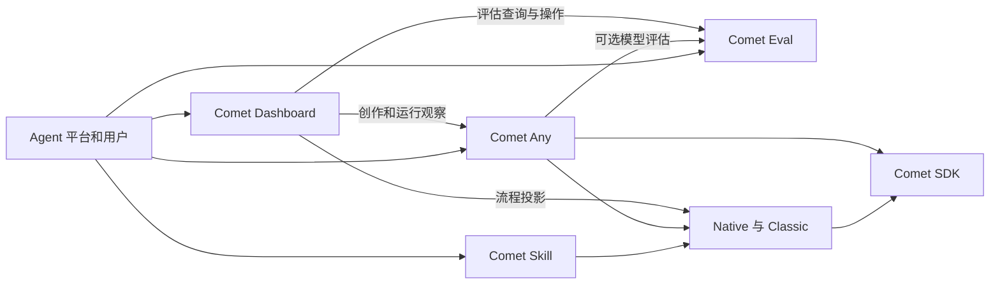

# Comet 现行架构

Comet 由五个可独立阅读的产品模块组成。Agent 平台负责推理、Skill 调用和会话，Comet 将流程定义、决定、结果和恢复位置持久化。下图按调用与读取方向绘制，页面中的聚合视图可以从来源重建。

| 模块                                     | 负责的事实                                             | 从哪里进入                                         |
| ---------------------------------------- | ------------------------------------------------------ | -------------------------------------------------- |
| [Comet Skill](comet-skill.zh.md)         | 内置 Skill 与平台安装、结构化 Skill 包、独立 Skill Run | `/comet`、`comet skill`                            |
| [Comet Any](comet-any.zh.md)             | 创作方案、固定应用、分发预览与安装                     | `/comet-any`、`comet creator`、`comet application` |
| [Comet Eval](comet-eval.zh.md)           | 评估输入、用例、执行结果、报告与基线资格               | `comet eval`、Dashboard 的 Eval 页面               |
| [Comet Dashboard](comet-dashboard.zh.md) | 项目和 Run 的查询、索引、展示与明确的管理操作          | `comet dashboard`                                  |
| [Comet SDK](comet-sdk.zh.md)             | 版本化工作流、Run 推进、Action 回报和恢复契约          | `@rpamis/comet/runtime`、应用和插件导出            |

## 代码和状态归属

- `app/` 接收 CLI 输入并调用领域入口，`domains/` 管理领域决策和用例，`platform/` 适配文件、进程、Git 与 Agent 平台。`plugin/` 负责平台入口，`assets/` 随包分发 Skill 和由源码生成的 Runtime。
- 新建 Native 和 Classic Change 的 SDK Run 负责推进。各自领域保有方案、候选、验收、交付等规则及可读状态投影。已有旧格式由对应兼容运行时处理。入口依据当前选择路由到一个工作流，两个工作流各自维护目录与写入规则。详见 [Native/Classic 接入与恢复](runtime-sdk-native-classic-integration.zh.md)。
- 创作、工作流执行和评估有各自的身份。Creator Run 固定创作和交付决定，应用 Run 执行业务，Eval Run 保留实验记录。关联使用已记录的应用身份和证据。Dashboard 从这些来源读取并聚合。
- 通用术语见 [Comet 工作流语言](../../CONTEXT.md)。跨领域入口、依赖方向及兼容门面由 [仓库布局契约](../../config/repository-layout.json) 和 `pnpm lint:architecture` 检查。

## 文档维护

改变公开入口、状态归属、跨领域依赖、存储或恢复协议时，同步更新对应模块页的图和事实来源。协议细节保留在相应契约文档中，这里维护索引与稳定边界。设计和历史验证材料按原路径保留，并以对应版本、代码或报告解释当时的决策。

[0.4.0 架构回顾](ARCHITECTURE.md)保留早期架构和迁移背景。[回归案例维护](badcase-maintenance.zh.md)说明用户问题的证据要求和验证边界。
