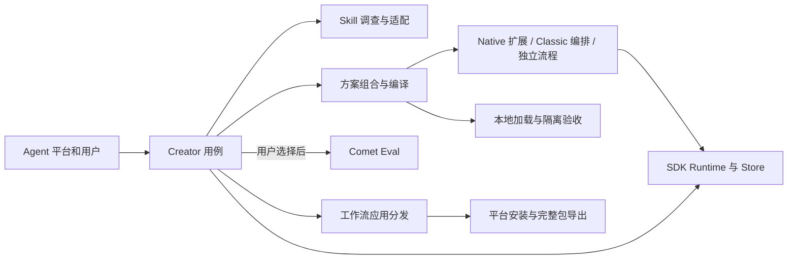
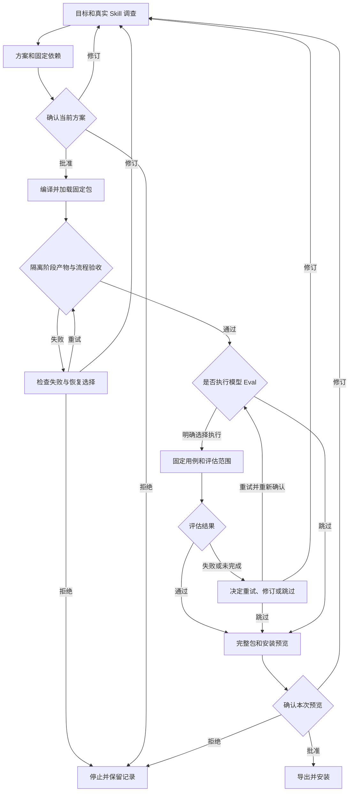
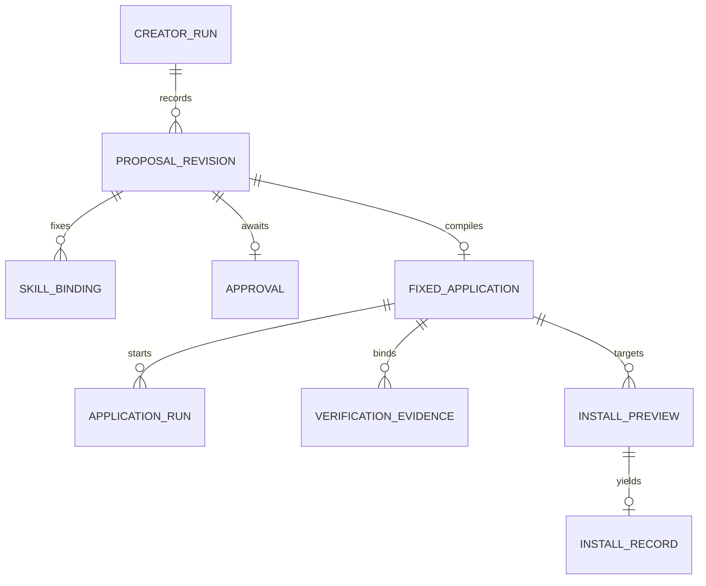

# Comet Any

`/comet-any` 通过 `comet creator` 从用户目标创作可恢复的工作流应用。Creator 使用固定的 SDK 定义。Agent 调查和编写业务内容，组合器根据已确认方案组装运行定义、入口 Skill、Rule、绑定与验证器。

## 创作与交付

恢复使用原 Creator Run 的 Action、Wait 和固定输入。结果未知时先核对环境中的原执行或产物。方案正文、依赖或安装预览变化后，按原流程重新确认受影响的决定。Native 和 Classic 组合沿领域工厂扩展，独立流程由自己的定义和验证器约束。详细分支及错误恢复以 [Creator 契约](workflow-creator.zh.md) 和 [编译契约](workflow-application-compiler.zh.md) 为准。

## 领域模型

Creator Run 保留方案和安装的确认上下文。应用 Run 执行已固定定义，Creator 与应用通过内容身份关联。SDK 子流程关系另由实际父子 Run 引用表达。阶段产物契约描述文件和内容要求，独立的本地、模型与 Agent 平台验证各自记录实际范围。`comet application` 管理固定应用的安装、导出和卸载。`comet bundle` 与 `comet publish` 仍是已有 Bundle 草稿和发布记录的入口。

| 职责               | 源码入口                                                                                                                                                                       |
| ------------------ | ------------------------------------------------------------------------------------------------------------------------------------------------------------------------------ |
| 用户入口与创作推进 | [Comet Any Skill](../../assets/skills-zh/comet-any/SKILL.md)、[creator.ts](../../app/commands/creator.ts)、[Creator 领域](../../domains/workflow-creation/creator.ts)          |
| 按方案组合与检查   | [编译器](../../domains/workflow-generation/compiler.ts)、[阶段产物验收](../../domains/workflow-generation/artifact-verification.ts)                                            |
| 应用加载、正式交付 | [应用入口](../../domains/workflow-application/index.ts)、[delivery.ts](../../domains/workflow-application/delivery.ts)、[平台适配](../../platform/install/application-host.ts) |

操作入口见 [工作流应用创建与交付](../operations/SKILL-CREATION-ZH.md)。
