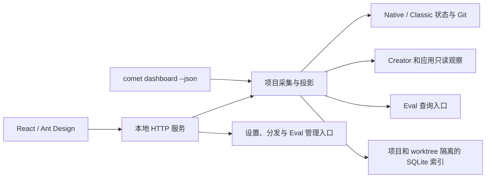
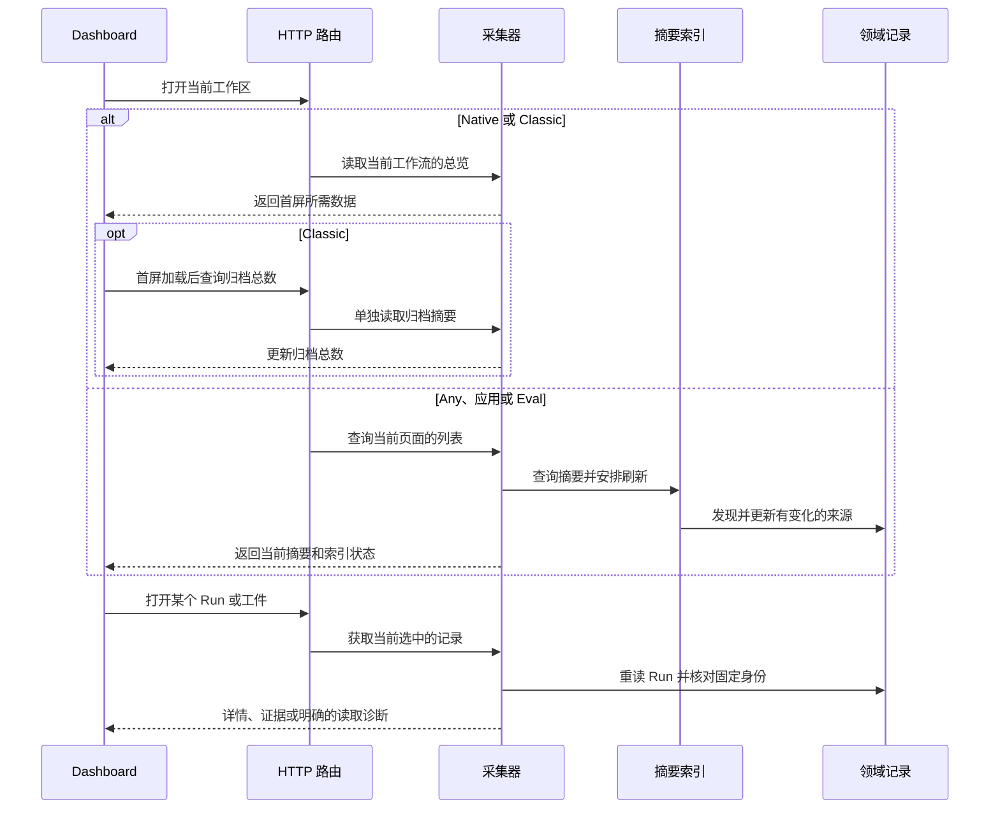
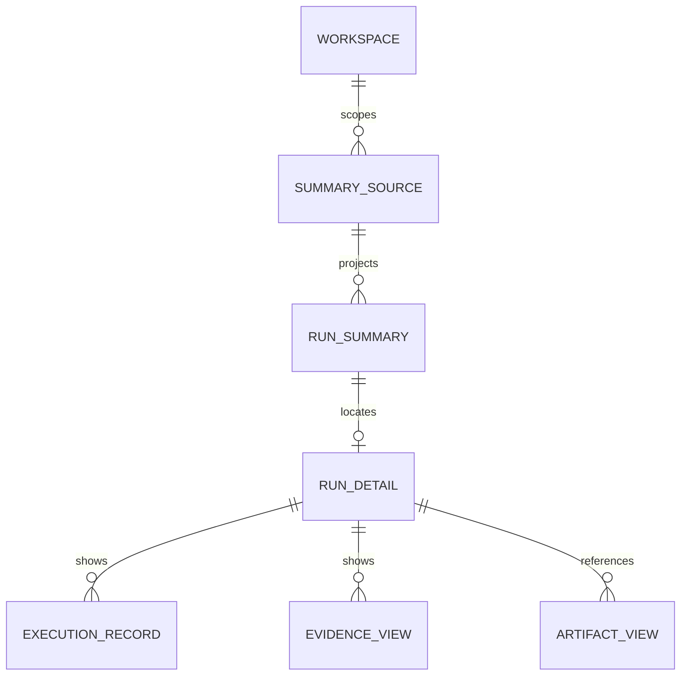

# Comet Dashboard

Dashboard 是项目观测和管理入口。React 和 Ant Design 界面通过本地 HTTP 服务取得 Native、Classic、Any 和 Eval 的视图。`comet dashboard --json` 提供一次性项目快照。项目设置、应用分发、评估管理、插件和记忆操作由对应入口执行。

## 查询与刷新

Native 和 Classic 的浏览器总览用 `/overview?workflow=native` 或 `/overview?workflow=classic`。Classic 活跃列表和摘要独立读取活跃目录，归档数量未读取时为 `null`，归档和全部页面继续使用原有分页。省略 `workflow` 时返回完整总览。`comet dashboard --json` 继续读取完整快照。插件目录用于导航，页面详情和项目配置在打开对应页面或设置时读取。

列表索引可以重建。详情从实际记录解析动作、决定、证据和子流程，保留读取失败与记录尚未同步的差别。浏览器刷新后恢复当前选择，观测结果未知的 Action 继续显示未知。预览工件以当前记录保存的标识和允许路径为准，应用观察的 JSON 投影在返回浏览器前过滤领取凭据等敏感字段。

## 读模型

应用观察按固定包身份关联 Creator 的本地和模型证据，另行显示历史或不可用的证据。读取详情只使用 SDK 观察入口和已保存的应用材料。运行中的创作、审批、重试与业务推进由 Agent 使用对应 Runtime；明确的分发操作交给应用领域。详见 [Any 过程观测](dashboard-any.zh.md)。

| 职责                             | 源码入口                                                                                                                                                                                                                 |
| -------------------------------- | ------------------------------------------------------------------------------------------------------------------------------------------------------------------------------------------------------------------------ |
| CLI、HTTP 与客户端               | [dashboard.ts](../../app/commands/dashboard.ts)、[server.ts](../../domains/dashboard/server.ts)、[界面](../../domains/dashboard/web/)                                                                                    |
| Native/Classic Change 和摘要索引 | [native-collector.ts](../../domains/dashboard/native-collector.ts)、[collector.ts](../../domains/dashboard/collector.ts)、[summary-index.ts](../../domains/dashboard/summary-index.ts)                                   |
| Any 和 Eval 的投影               | [application-collector.ts](../../domains/dashboard/application-collector.ts)、[application-evidence.ts](../../domains/dashboard/application-evidence.ts)、[eval-collector.ts](../../domains/dashboard/eval-collector.ts) |

运行和验证命令见 [Dashboard 开发说明](../../domains/dashboard/README.md)。
