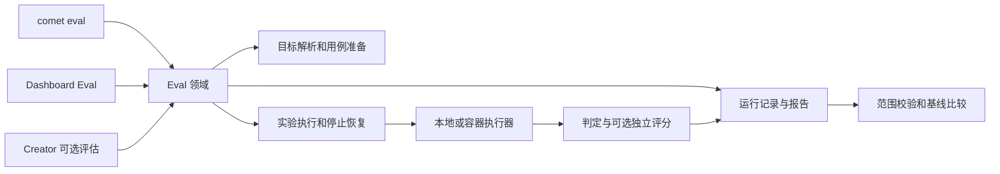
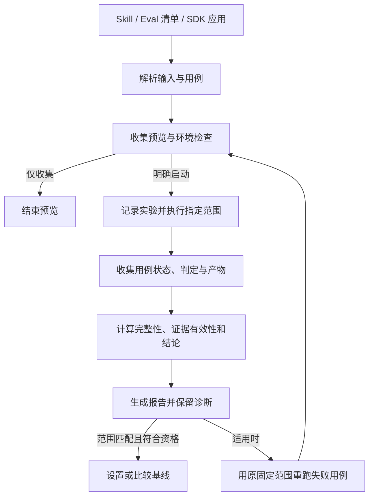
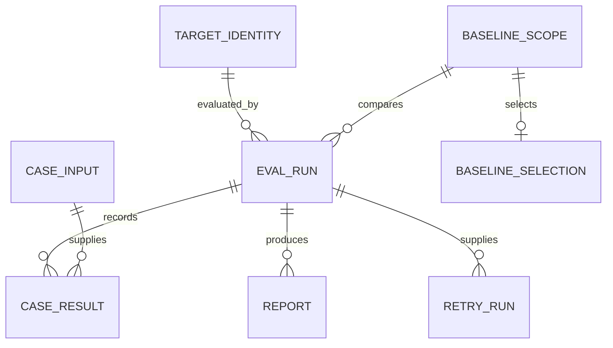

# Comet Eval

Comet Eval 从明确的目标、用例和执行配置生成可复查的评估结果。CLI、Dashboard 和 Creator 复用 Eval 领域规则，并保有各自的用户确认入口。确定性的 `comet skill check` 和 Creator 本地产物验收各有自己的证据来源。

## 评估生命周期

应用评估固定整包内容与所用用例。Skill 可从本地目录或 `SKILL.md` 解析，也可使用 `comet/eval.yaml` 定义的用例。执行 Agent 和独立 Judge 保存各自的执行证据，报告展示实际覆盖。中断的运行保留已完成记录，停止与修复根据实验、进程和容器的已记录归属处理。

## 领域模型

每个基线范围按目标、用例和评分等比较条件确定，最多选择一个默认基线。报告分别保留执行状态、完整性、证据有效性、质量和结论。失败用例重跑产生新记录并绑定来源，局部结果继续作为局部证据。Dashboard 从 Eval 入口读取列表、详情、报告和可用操作，应用交付依据已保存且与固定包匹配的评估证据。

| 职责                 | 源码入口                                                                                                                                                                                    |
| -------------------- | ------------------------------------------------------------------------------------------------------------------------------------------------------------------------------------------- |
| 公开入口与目标解析   | [eval.ts](../../app/commands/eval.ts)、[standalone-context.ts](../../domains/eval/standalone-context.ts)                                                                                    |
| 预览、应用输入与运行 | [eval-run-preview.ts](../../domains/eval/eval-run-preview.ts)、[application-eval.ts](../../domains/eval/application-eval.ts)、[eval-run-manager.ts](../../domains/eval/eval-run-manager.ts) |
| 记录、基线和失败重跑 | [eval-run-store.ts](../../domains/eval/eval-run-store.ts)、[eval-run-retry.ts](../../domains/eval/eval-run-retry.ts)                                                                        |
| 隔离执行和数据集     | [Eval 执行目录](../../eval/)、[builtin-datasets.ts](../../domains/eval/builtin-datasets.ts)                                                                                                 |

操作说明见 [Comet Eval 使用指南](../operations/EVAL-USAGE-ZH.md)。修改模型 Eval 的操作流程时，按根 [AGENTS.md](../../AGENTS.md) 核对启动授权及场景范围。
