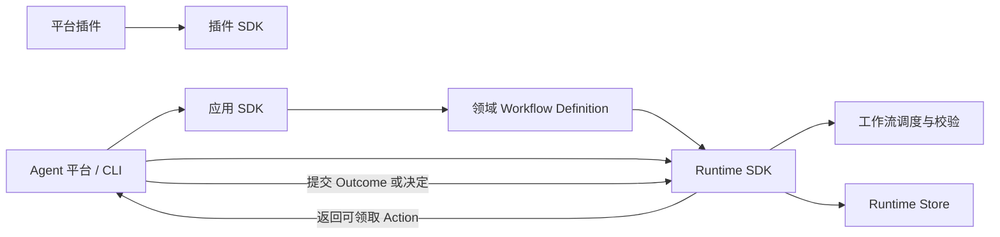
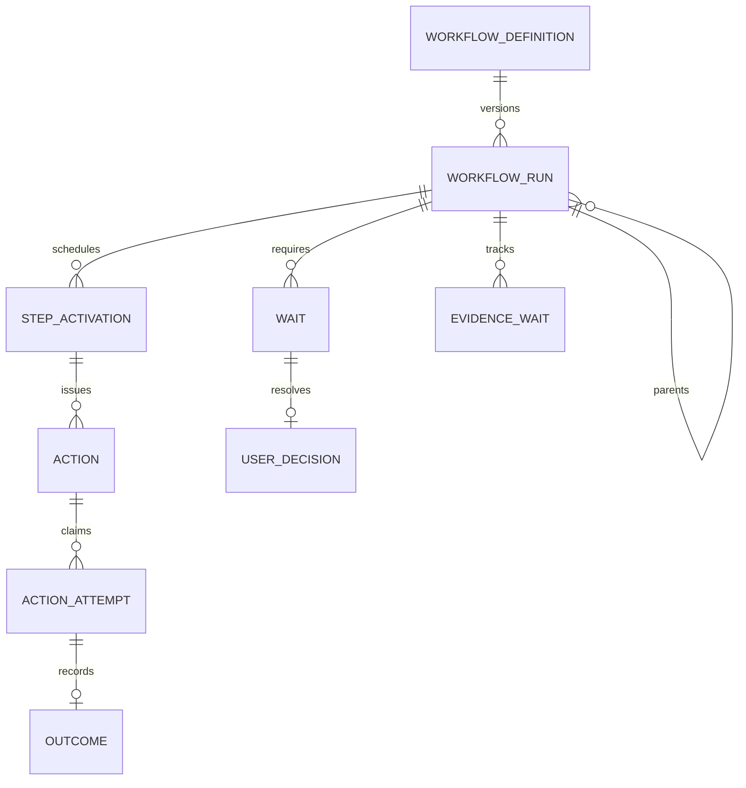
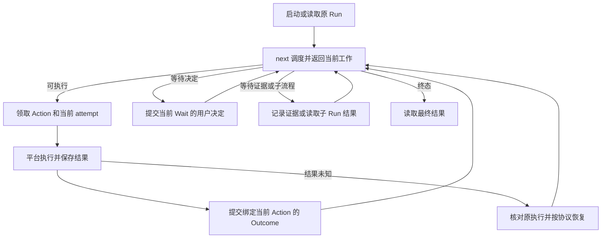

# Comet SDK

Runtime SDK 管理版本化工作流、运行状态、Action、决定和恢复。Agent 平台通过注册的执行端口落实 Skill、工具和交接。应用 SDK 将领域流程、适配契约、工件和分发组装为完整应用。插件 SDK 提供独立的平台插件契约。

| 公开导出                                                                    | 用途                              |
| --------------------------------------------------------------------------- | --------------------------------- |
| `@rpamis/comet/runtime`                                                     | 定义、调度、Store、执行端口和恢复 |
| `@rpamis/comet/applications`                                                | 加载、适配、观察、分发与证据      |
| `@rpamis/comet/applications/native`、`@rpamis/comet/applications/classic`   | 对应领域的应用组合工厂            |
| `@rpamis/comet/applications/creator`、`@rpamis/comet/applications/compiler` | 创作 Runtime 和确认方案编译       |
| `@rpamis/comet/plugins`、`@rpamis/comet/plugins/comet`                      | 插件 SDK 和 Comet 平台集成        |

## Run 与动作

Run 固定 Workflow Definition 及其输入，包含已就绪工作、执行尝试、决定、证据和子 Run 引用。每次写入核对相应 Run revision。调度器按合法边、触发条件与步骤约束推进，Store 保存可恢复记录。业务验证器和原领域规则决定某个结果是否足以完成业务步骤。读取接口可以只返回必要投影。

进程退出后先读取原 Run，已领取或结果未知的动作按执行证据恢复。通用 SDK 提供内存与文件 Store。内置业务应用另有工作区定位和可移植检查点，用于对应 Change 的恢复。公开协议见 [Runtime SDK](runtime-sdk.zh.md)、[本地存储](runtime-local-storage.zh.md)、[恢复与规模](runtime-recovery-and-scale.zh.md) 和 [发布契约](sdk-release-contract.zh.md)。

只读使用 `inspect` 或 `query`。`next` 可以保存调度结果，也会协调实际子流程的启动与推进。

| 职责               | 源码入口                                                                                                                                                                                |
| ------------------ | --------------------------------------------------------------------------------------------------------------------------------------------------------------------------------------- |
| Runtime API 和定义 | [runtime.ts](../../domains/engine/runtime.ts)、[workflow-definition.ts](../../domains/engine/workflow-definition.ts)                                                                    |
| Run、调度和 Store  | [workflow-run.ts](../../domains/engine/workflow-run.ts)、[workflow-scheduler.ts](../../domains/engine/workflow-scheduler.ts)、[runtime-store.ts](../../domains/engine/runtime-store.ts) |
| 执行端口与应用适配 | [runtime-handlers.ts](../../domains/engine/runtime-handlers.ts)、[应用 SDK](../../domains/workflow-application/index.ts)                                                                |
| 插件与发布入口     | [插件 SDK](../../domains/comet-plugin/sdk.ts)、[包导出](../../package.json)、[API 快照](../../config/sdk-api/)                                                                          |

首次接入见 [SDK 快速接入](sdk-getting-started.zh.md)。
