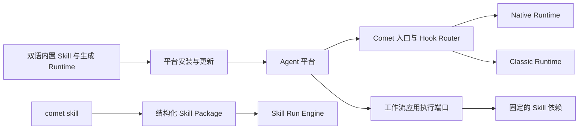
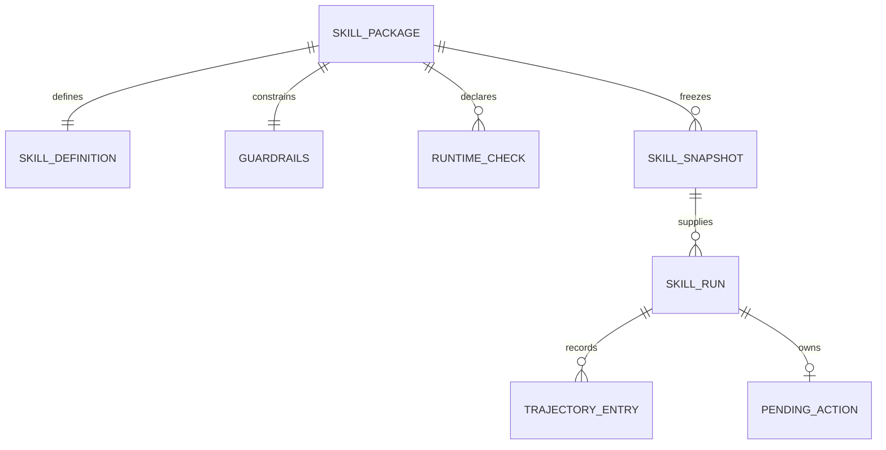
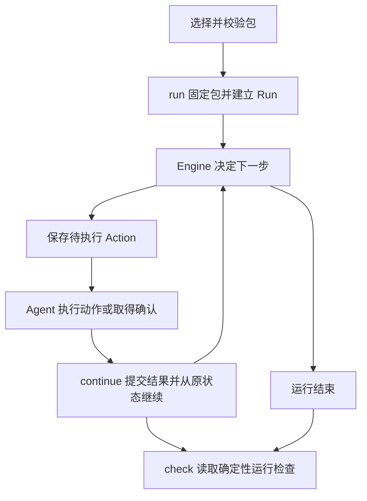
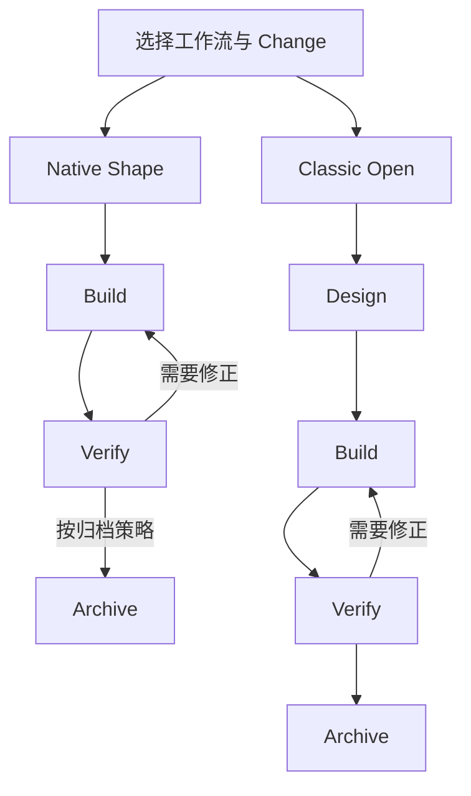

# Comet Skill

Comet 有三条 Skill 使用路径。内置 Skill 随平台安装，由 Agent 加载。结构化 Skill Package 可在项目池中发现和调试。作为工作流应用依赖的 Skill 由应用固定并通过 SDK Action 调用。

## 结构化 Skill 与 Run

`comet skill add` 校验结构化定义后安装到项目 Skill 池。解析优先顺序是显式目录、`.comet/skills/<name>`、内置包目录。选定的包必须通过结构、语义及名称校验。项目同名包无效时直接报告该包。`comet skill show` 读出包身份与检查项。

`run`、`continue` 和 `check` 使用同一 Change 目录或同一项目的独立 Run ID。独立 Run 位于 `.comet/runs/<id>`。已有 Run 使用固定快照，显式 `--upgrade` 才会检查并切换到兼容的新快照。运行检查读取已记录的状态或工件。

## 内置工作流

图中是普通单 Change 和 Classic full 主路径。Native Supervisor 使用独立 Child 与 worktree，父级协调集成、验收与交付。Classic 的 `hotfix`、`tweak` 使用各自的预置路径，保有领域批准和产物检查。Router 使用当前选择路由一个 Guard，Agent 平台安装同一套共享 Rule 和平台支持的 Hook 入口。平台安装、Hook、领域状态与 SDK 的边界见 [Native/Classic 接入设计](runtime-sdk-native-classic-integration.zh.md)。

| 职责                     | 源码入口                                                                                                                                                         |
| ------------------------ | ---------------------------------------------------------------------------------------------------------------------------------------------------------------- |
| CLI 与包发现             | [skill.ts](../../app/commands/skill.ts)、[discovery.ts](../../domains/skill/discovery.ts)、[load.ts](../../domains/skill/load.ts)                                |
| 快照与手动运行           | [snapshot.ts](../../domains/skill/snapshot.ts)、[manual-run.ts](../../domains/engine/manual-run.ts)、[standalone-run.ts](../../domains/engine/standalone-run.ts) |
| 平台安装、路由与内置文件 | [platform-install.ts](../../domains/skill/platform-install.ts)、[入口领域](../../domains/comet-entry/)、[发布清单](../../assets/manifest.json)                   |
| 工作流应用依赖           | [skill-adapter.ts](../../domains/workflow-application/skill-adapter.ts)、[skill-executor.ts](../../domains/workflow-application/skill-executor.ts)               |
