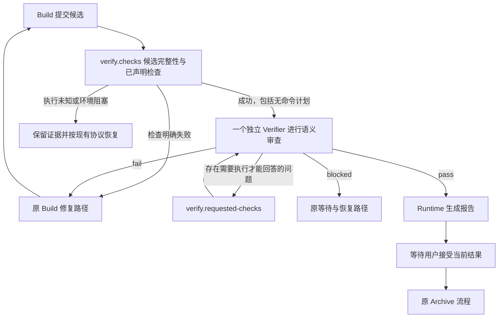

# Native Verify bugfree 完整目标规格

本规格承接来源的完整行为与实施约束。第1、3—14节为产品约束，第15—18节为验证与交付约束，第2、19节为基线和研究背景。来源中的“当前”“待实施”描述比较基线及实施顺序，不表示允许省略目标行为。

本能力补充 Native 验证能力，standard 保持比较基线；bugfree 使用本规格第6节的独立续审规则。Compat 与 Classic 沿用原协议。

## 1. 目标与已确定的产品决策

**在保持最终交付正确率的前提下，极致压缩 Verify 的墙钟耗时和 token 消耗。** bugfree 是 Native 的可选验证模式，验收仍在 Verify 阶段完成。

充分信任前沿 Agent 对需求、代码语义、系统行为和影响范围的理解。保留一个独立 Verifier，用于降低沿袭 Builder 错误假设的机会。Verifier 自主选择是否需要执行测试或其他检查，Runtime 不用代码行数、文件数、风险评分或语言白名单代替语义判断。

以下决策是实施约束，不留给实现者重新选择：

| 编号 | 决策                                                                                                                                                         |
| ---- | ------------------------------------------------------------------------------------------------------------------------------------------------------------ |
| D01  | 模式名称为 `bugfree`，现有行为名称为 `standard`；缺省为 `standard`。                                                                                         |
| D02  | Shape、Build、Verify、Archive 的阶段和用户决定保持原有职责。                                                                                                 |
| D03  | 每份进入最终 Verify 的候选都必须获得独立 Verifier 的有效结论，主 Agent 无权自行免除。                                                                        |
| D04  | 同一时刻每份候选最多一个正式 Verifier；不默认增加第二个 Reviewer、多个专家、投票或独立 Judge。                                                               |
| D05  | 首轮 Verifier 使用未参与实现的独立上下文；同一需求的修复轮允许复用原 Verifier 上下文。                                                                       |
| D06  | Verifier 以语义审查为默认方法；是否补读、执行、测试由它决定，不要求每项验收对应一条测试。                                                                    |
| D07  | 用户、项目规则、已确认需求明确要求的检查必须遵守；已经提交的必需检查不能被 bugfree 静默忽略。                                                                |
| D08  | 候选、工作区、批准、Action、执行身份和证据完整性检查继续由 Runtime 执行。                                                                                    |
| D09  | 全部验收项仍须得到结论；允许紧凑回报，禁止默认补齐未判断的验收项。                                                                                           |
| D10  | 不增加置信度评分、证明文档、逐项免测申请或风险分类 Agent。                                                                                                   |
| D11  | 模式在 Run 创建时固定；修改项目配置只影响以后创建的 Run，不改变正在执行的验收策略。                                                                          |
| D12  | 首版覆盖新 SDK Native Run 的最终 Verify，包括普通 change 和 Supervisor 父级最终验收。Supervisor 的 Child 实现、Child 验收与集成检查仍按现有 Build 协议执行。 |
| D13  | 已有 SDK Run、Compat Native、Classic 和已固定的旧 SDK 应用不自动升级到 bugfree。                                                                             |
| D14  | 未完成、超时、缺少必要信息、无法取得独立会话都不能转换为通过。                                                                                               |
| D15  | 模式本身不允许执行 Eval、不扩大写入权限、不自动接受结果或归档。                                                                                              |
| D16  | 正确率和成本收益分别验证；没有真实对照结果前，只能报告功能完成，不能报告“正确率不降”或具体加速比例。                                                         |

`bugfree` 是用户选择的模式名称。通过表示当前候选满足已确认验收要求，报告必须说明采用的验证方法，不能把语义审查写成形式化证明或实际测试。

## 2. 当前实现与本次变化位置

本节根据比较基线的源码核对，不依赖历史讨论中的行为推断。

| 当前实现                                                   | 已核对事实                                                                                                                                         | bugfree 的改动                                                         |
| ---------------------------------------------------------- | -------------------------------------------------------------------------------------------------------------------------------------------------- | ---------------------------------------------------------------------- |
| `domains/workflow-contract/types.ts`、`project-config.ts`  | Native 配置含产物路径、语言、澄清方式、归档确认及 Verify 失败次数等，没有 Native 验证模式字段。                                                    | 增加一个模式字段及其完整配置生命周期。                                 |
| `native-sdk-create.ts`                                     | 创建 Run 并保存输入，恢复可复用完整 portable checkpoint。                                                                                          | 创建时固定模式；从 checkpoint 恢复时保留原模式。                       |
| `native-sdk-application.ts`                                | 普通路径为 Builder → `verify.checks` → `verify.verifier` → `verify.report` → 用户接受；Verifier 必须使用与当前 Builder 不同的会话身份。            | 保留步骤，改变 bugfree 的任务内容、回报形式及会话复用策略。            |
| `native-sdk-checks.ts`                                     | `nativeSdkCheckPlans` 将未提供的 `verificationChecks` 解释为空数组；普通最终 Verify 没有强制非空计划。检查复用绑定完整输入、执行上下文及原始日志。 | bugfree 模板默认空计划；空计划继续建立候选完整性记录，不创建虚构测试。 |
| `native-sdk-checks.ts`                                     | Supervisor Child 检查与 Child 集成检查目前要求非空计划。                                                                                           | 本次不放宽这些 Build 内检查。父级最终 Verify 可使用 bugfree。          |
| `native-sdk-continuation.ts`                               | Builder 模板预填检查占位项；Verifier 模板要求逐项 `id/result/reason`。                                                                             | bugfree 去除无实际要求的检查占位项，并提供紧凑的通过项回报。           |
| `native-task-context.ts`                                   | 已要求交接时不传递 Builder 自评结论。                                                                                                              | 延续并落实到 bugfree 专用任务包；完整开发历史不交给 Verifier。         |
| `native-sdk-application.ts`                                | 同一次验收请求补充检查后，后续结果要求维持原 Verifier 执行身份。                                                                                   | 继续使用此行为；补查返回原会话，不启动另一轮独立审查。                 |
| `native-loop-runtime.ts`                                   | 一次 attempt 最多两轮补充检查；项目默认最多五次 Verify 失败。                                                                                      | 保持现有上限与恢复协议，不再增加一套预算。                             |
| `native-sdk-report.ts`、`native-verification-report-v2.ts` | Runtime 生成报告，接受前重新核对候选与检查，报告生成失败可保留已经完成的验收。                                                                     | 报告增加实际模式和方法，不让 Agent 再写一份报告。                      |

配置名称沿用仓库已有的 `verify_mode` / `verifyMode` 命名习惯，并限定在 Native 命名空间。Classic 已有 `verify_mode: light/full`，其字段、值与语义不改动。

已检查相关配置 Git 历史与当前解析、序列化、合并路径。没有发现 Native 曾公开使用 `bugfree` 的记录；Native 输出术语过滤器中的 `verify_mode` 字符串不是已存在的配置支持。历史 snapshot 预算字段与本功能无关，不恢复或换名新增文件数、总字节、扫描时限等项目级限额。

## 3. 使用方式与模式固定

### 3.1 唯一新增项目配置

```yaml
native:
  verify_mode: bugfree
```

允许值仅为 `standard`、`bugfree`。省略时使用 `standard`。`null`、布尔值、数组、空串、大小写变体及其他字符串均报配置错误，不静默退回默认值。

配置注释使用以下中文语义：

> 新建 Native change 的最终 Verify 模式。standard 使用现有验证流程；bugfree 由独立 Agent 进行语义审查，并按需要补充检查。已创建的 change 保持原模式。

首版不增加模型选择、审查人数、测试比例、最大文件数、最大 token 或“信任等级”等配置，也不增加 `native new` 的模式覆盖参数。

### 3.2 配置读取与生命周期

1. `createNativeSdkChange` 在原创建锁保护下读取有效项目配置，将模式写入新 Run 的 `input.verifyMode`。
2. 项目没有显式值时写入 `standard`。新 Run 始终保存明确值，不能依赖以后重新读取项目配置来推断。
3. Shape 确认展示实际模式，在现有一次 Shape 确认中说明；不新增确认步骤。
4. 项目初始化生成 `standard`；`init`、`update`、配置合并及保留未知字段的路径均保存用户已有值。
5. 全局配置的同名 Native 字段按共用类型解析和保存，但不增加运行时全局覆盖逻辑。Run 仍只读取其项目配置；只有现有初始化流程明确采用的配置才会进入项目。
6. 不新增 `.comet/config.yaml` 之外的模式文件，不修改本仓库当前配置来证明方案已经启用。

### 3.3 已有 Run 与中途切换

| 情况                                      | 唯一处理结果                                                                                                       |
| ----------------------------------------- | ------------------------------------------------------------------------------------------------------------------ |
| 新建 Run，项目为 `bugfree`                | 固定为 bugfree。                                                                                                   |
| 新建 Run，项目缺省或为 `standard`         | 固定为 standard。                                                                                                  |
| 已有 Run 缺少模式字段                     | 按 standard 处理，不读取当前项目的 bugfree 值代替。                                                                |
| 执行中修改项目模式                        | 当前 Run 保持原模式，状态输出说明配置只影响新 change。                                                             |
| 对现有 Run 重新确认 Shape                 | 保留创建时模式，不借需求修订切换验证策略。                                                                         |
| 用户要求当前 Run 切换模式                 | 首版不支持原地切换；说明当前模式并继续原 Run，或由用户明确决定结束当前 Run 后新建 change。不得自动取消或复制 Run。 |
| checkpoint 恢复                           | 使用原 Run 输入和固定定义，不用本机配置覆盖。                                                                      |
| 缺少完整历史、只能重新开始 Shape 的旧恢复 | 使用 standard；不能从当前配置推断旧任务获得过 bugfree 授权。                                                       |
| 伪造 `verifyMode: bugfree` 给旧定义       | 拒绝模式与定义不匹配，不能只靠字段获得新行为。                                                                     |
| 新定义携带未知模式                        | 拒绝启动或恢复，保留原记录。                                                                                       |

mode 固定与检查输入新鲜度分别处理。修改配置不改变策略，但配置文件本身发生变化仍按现有输入观察规则处理，不能直接忽略整个配置文件。

## 4. 支持范围

| 运行对象                                                 | bugfree 行为                                                                     |
| -------------------------------------------------------- | -------------------------------------------------------------------------------- |
| 新 SDK Native 普通 change                                | 支持最终 Verify。                                                                |
| 新 SDK Native linked worktree                            | 支持，验证绑定实际工作区和当前候选。                                             |
| 新 SDK Native Supervisor 父级最终 Verify                 | 支持，针对集成后的父级候选独立判断全部父级验收项。                               |
| Supervisor Child Builder、Child Verifier、Child 集成检查 | 继续当前 Build 协议，不因父级模式减少检查或省略 Child 验收。                     |
| Supervisor 父级修复后再次进入 Verify                     | 使用 bugfree，允许满足第 6 节条件的父级 Verifier 续审。                          |
| Compat Native                                            | 不改变；配置字段不替代其原有协议。状态不能把它标为 bugfree。                     |
| Classic                                                  | 不改变。                                                                         |
| 已固定的旧 Native SDK 扩展应用                           | 继续原定义和 standard 语义。                                                     |
| 使用新 Native 工厂创建的扩展应用                         | 可以使用新模式；扩展登记的审查步骤、验证器和授权仍全部执行，bugfree 不跳过扩展。 |
| 历史归档                                                 | 不回填模式、不重写报告、不重新验收。                                             |

Supervisor 的完整任务耗时包含 Build 中的 Child 工作，不能把父级 Verify 的加速比例宣传为整个 Supervisor 的加速比例。

## 5. Verify 的固定执行顺序



`verify.checks` 保留为一个内部 Action，不改成 Agent 需要手工调度的新阶段。没有命令时完成当前候选的绑定与完整性观察，随后直接交给 Verifier。空计划不启动 shell，不生成“测试通过”条目。

主 Agent 在 Verify 中只负责启动或恢复正式 Verifier、转交 Runtime 返回的必要信息、处理实施修复和向用户说明结果。不要再要求主 Agent 独立完成一次全量自审后，才允许启动正式 Verifier。

主 Agent 发现明确问题仍应如实处理。bugfree 不要求隐瞒问题或等 Subagent 再发现同一个问题。

## 6. 独立 Verifier 的身份和上下文生命周期

### 6.1 首轮独立性

首次进入最终 Verify 必须使用独立会话。该会话不能是当前 Run 中参与过产品实现的 Builder、父级 Builder 或集成修复会话，也不能通过更换一个字符串把原主会话声明为独立会话。

平台提供真实任务或会话标识时使用实际标识。平台只能使用现有 Native 能力核对中的兼容身份方式时，继续其原约束，不宣称 Runtime 能单独证明上下文隔离。

能力要求为：能够创建独立只读审查上下文，能够回报真实会话身份，能够通过当前 Action 领取和回报。不能满足时返回 blocked；不自动降为主 Agent 自审。

### 6.2 同一候选请求补查

Verifier 用当前 `request-checks` 协议一次请求当前已知的全部必要检查。Runtime 执行后，把结果交回同一个会话。

不将一次补查拆成“新 Verifier → 重读需求 → 重读全部实现 → 再补查”。保持当前同一 attempt 执行身份约束和两轮补查上限。超过上限仍按现有协议报告未解决问题，不假定所有疑问已经消失。

### 6.3 修复后的续审

以下条件同时成立，允许继续使用原独立 Verifier：

1. Run、工作区归属、已批准需求和验收 ID 集合保持一致。
2. 原会话仍可恢复，并且此前只承担审查，没有参与修改候选实现。
3. 原会话没有仍在执行或结果未知的旧 Action。
4. Runtime 给出新候选、新 Action 和新领取模板；不能重用旧领取令牌提交新候选。
5. 续审输入包括前一次正式结论、从原审查候选到当前候选的实际差异，以及完整当前验收 ID 索引。

续审由 Verifier 判断影响范围。它必须重新确认全部验收项的结论，但可直接延续未受影响项的语义判断，不要求重新读取所有文件、重跑检查或重复逐项论证。

发生需求实质修订、工作区切换、原会话丢失、原 Verifier 参与实现或无法确认独立身份时，创建新的独立会话。新会话读取当前任务包，不把旧通过结果作为无需审查的指令。

### 6.4 并发、超时与失联

同一候选同一时刻只存在一个正式 Verifier。等待工具超时不等于 Agent 执行超时；继续等待同一任务，不并行启动替代者。

任务明确结束、失败、丢失或平台确认执行超时后，按原失败/停止确认协议记录事实再恢复。未知执行不得直接重派。修复候选不能绕过旧执行未停止的限制。

不新增固定的“30 秒必须通过”或 token 截断规则。若执行平台限制导致审查未完成，结果为 blocked 或执行错误，绝不为了达到性能指标改写为 pass。

### 6.5 模型与工具能力

Verifier 使用当前 Agent 平台能够提供、符合用户模型选择的前沿模型。首版不为节省 token 自动切换成能力较弱的模型，也不强制不同厂商模型交叉审查。模型名称和实际能力由平台决定，Comet 不在项目配置中维护模型等级表。

Verifier 的任务说明禁止派生新的审查 Subagent。平台能够限制工具时，不向它提供继续创建 Agent 的能力；读取工具和当前 Runtime 领取/回报能力保留。Runtime 只能约束自己登记的 Action，不能声称能够发现平台外全部未登记 Agent，因此真实平台测试必须核对实际派发数量。

## 7. Verifier 任务包

### 7.1 必须提供的信息

任务包直接由 Runtime 和平台交接适配生成，不要求 Builder 编写一份新的解释文档。它包含：

- 当前模式、Run、Action、候选和实际工作区身份；机器字段由当前模板携带。
- 已批准 brief、目标 Spec 和适用项目规则的读取引用。
- 全部验收项的 ID、正文和来源；现有分页协议必须保证全部页面可读，禁止只交前几个条目。
- 当前候选相对于已批准实现起点的实际文件变化，包括删除、重命名、未跟踪文件与模式变化；内容受现有候选快照约束。
- 本轮和可复用的真实检查摘要：名称、结果、原执行来源、日志引用。
- 已知未解决问题、实际失败和环境阻塞；不得为缩短上下文过滤掉失败记录。
- 修复续审时的前次正式结果，以及前次候选到当前候选的差异。
- 领取、补查、结果回报和执行失败的当前模板。

普通首次审查的 diff 起点是 change 的实现基线；修复续审另提供相邻候选差异。不能只给最近一次 commit diff，导致同一 change 较早实现的行为从首次验收中消失。

### 7.2 默认不传递的信息

不传完整开发对话、Builder 的自评通过结论、重复的实现过程叙述、全部历史 Action 累积输入、成功日志正文和不适用 Skill 全文。

需求原文、明确约束、实际失败及必要设计决定属于事实。即使它们曾由 Builder 整理，也不能为了“独立”而删除；Verifier 可按来源读取原文。

### 7.3 按需读取与完整性

首先提供当前任务所需的事实和引用。Verifier 自主决定需要读哪些实现、调用者、数据定义或配置；允许读取 diff 之外的相关代码。

不新增静态依赖图生成器、全仓库索引或文件数量门槛。Runtime 不判断“这些文件足以理解语义”。如果引用不可读、源码不完整、生成输入不稳定或 diff 无法覆盖实际候选，报告具体缺项，不能把截断后的任务包当成完整材料。

已有 `contextDelivery` 足够且与当前 Action 匹配时直接使用；只有缺失、失效或确有额外信息需要时再请求上下文。不因进入补查回合就重复获取同一批项目知识。

精简必须作用于实际进入模型的工具结果。Native 的 bugfree 回报模板只提供当前使用的紧凑内容，不并排展开另一份完整结果模板。对公开 SDK 仍要求返回完整 Run 的接口保持兼容；平台调用方沿用“保存完整 stdout、只提取当前 continuation/任务包”的方式，不将整份历史 JSON 打印进模型上下文。不能仅在 UI 中折叠长输出就宣称节省了输入 token。

### 7.4 新增交接信息的最小结构

在当前 Native continuation/pending Action 输出中增加 `verificationContext`，字段语义固定如下。以下字段是只读投影，不保存第二套流程状态。

| 字段              | 类型与语义                                                                                                   |
| ----------------- | ------------------------------------------------------------------------------------------------------------ |
| `verifyMode`      | `standard` 或 `bugfree`，来自固定 Run 输入。                                                                 |
| `candidateId`     | 当前被审查候选，必须与 Action 绑定相同。                                                                     |
| `requirementRefs` | 已批准 brief、Spec 和必要约束引用，不接受随意替换的主 Agent 摘要。                                           |
| `acceptance`      | 当前全部 `{id, source, text}`；分页时使用原分页契约。                                                        |
| `changeRefs`      | 当前候选的完整变化引用；续审额外包含相邻候选变化引用，分别标明起点。                                         |
| `checkEvidence`   | Runtime 检查摘要和原日志引用，含复用来源；不内嵌成功日志全文。                                               |
| `previousReview`  | 无则省略；存在时给出原 Action、原候选和正式结果引用。                                                        |
| `session`         | `{strategy: "fresh"}` 或 `{strategy: "resume", sessionId, previousActionId}`；后者只能来自已验证的会话关联。 |

文件引用复用现有受保护的项目路径和 workspace Runtime 路径机制。不得把任意外部路径或命令文本解释为自动执行指令。新增变化摘要如果需要持久化，只写入现有用户级 Runtime 目录，不放进 change 根目录，也不由 Agent 手工生成。

## 8. Verifier 的工作规则

### 8.1 审查目标

Verifier 要判断最终实现是否满足用户已确认的需求、是否破坏与本次改动相关的既有行为，以及是否存在影响交付的实际问题。它可以使用对系统和代码语义的理解直接完成判断。

审查按实际内容进行，不固定要求逐条输出调用链、枚举所有异常输入、列满风险清单或为每个判断构造测试。业务需要的防御逻辑与不必要的防御逻辑由 Agent 根据真实系统判断。

### 8.2 工具触发条件

以下情况由 Verifier 自主判断后选择最小有效操作，无需先提交申请表：

| 当前需要解决的问题                 | 可选择的操作                                             |
| ---------------------------------- | -------------------------------------------------------- |
| 需求或语义能从当前代码直接判断     | 给出审查结论，无需运行命令。                             |
| 缺少调用关系、配置或数据定义       | 补读相关源码或原始资料。                                 |
| 无法从阅读确认具体运行表现         | 请求最小命令、程序示例、定向测试或实际界面观察。         |
| 用户或项目规则明确要求执行某项检查 | 确认已有有效结果，缺失时请求执行。                       |
| 实际失败需要定位                   | 使用真实结果与最小补查定位，不能仅用推理把失败改为通过。 |
| 信息或环境无法取得                 | 返回 blocked，说明缺什么及恢复条件。                     |

不要为了证明使用了 bugfree 而拒绝必要测试；也不要为了证明审查认真而运行没有具体判断价值的检查。

### 8.3 停止条件

只有以下条件同时满足，才能提交 pass：全部验收项已经判断为通过；没有未解决的相关缺陷；没有阻碍判断的必要信息缺失；所有当前必须执行的检查已有有效通过证据；候选仍与审查对象一致。

满足后结束本轮，不默认追加另一名 Reviewer、不重复自审、不要求“再找几个问题”。允许输出没有发现问题的结论，不设发现问题的数量指标。

代码格式偏好、无实际用途的抽象建议、假想的不可达输入，以及本次没有修改且不影响验收的历史问题，不作为新增阻塞。若项目明确把某条规范列为验收条件，仍须遵守该条件。

### 8.4 判定结果

| 结果      | 定义                                                                                         | 后续                                       |
| --------- | -------------------------------------------------------------------------------------------- | ------------------------------------------ |
| `pass`    | 当前全部验收项通过，满足本节停止条件。                                                       | Runtime 生成报告并等待用户接受。           |
| `fail`    | 至少一个验收项存在明确不符合要求的实现行为。                                                 | 返回原 Build 修复路径。                    |
| `blocked` | 没有足够条件完成判断，例如必要环境或信息缺失；不能用 fail 代替未知，也不能用 pass 忽略未知。 | 使用原等待与恢复协议。                     |
| 执行错误  | Agent 没有完成一次有效审查，例如失联、工具执行崩溃、领取身份错误。                           | 记录原 Action 的实际失败；不伪造验收结论。 |

同时存在明确失败和信息缺失时，整体 verdict 使用 fail，分别保留 failed 与 blocked 的验收项。全部已判项通过但仍有 blocked 项时，整体 verdict 使用 blocked。

## 9. 哪些检查可以省略

### 9.1 三类检查

| 类别                             | 示例                                                                               | bugfree 权限                                     |
| -------------------------------- | ---------------------------------------------------------------------------------- | ------------------------------------------------ |
| Runtime 完整性与授权检查         | 候选摘要、工作区归属、批准绑定、claim、检查收据、执行停止事实、归档事务            | 必须保留，模型无权豁免。                         |
| 当前任务的必需执行检查           | 用户明确指定命令、适用项目规则要求的检查、已确认验收指定的运行验证、已登记扩展检查 | 必须取得有效结果；允许复用合格旧证据。           |
| Agent 为判断实现而自行选择的检查 | 对局部逻辑补一个例子、临时验证某种行为、追加定向测试                               | 由独立 Verifier 决定是否需要；没有需要时不执行。 |

Runtime 不解析自然语言并声称已经穷尽所有必需检查。Builder 和 Verifier 负责理解用户要求及项目规则，Verifier 独立核对是否遗漏。Runtime 对已经登记的计划执行确定性约束。

### 9.2 `verificationChecks` 的固定语义

保留现有字段：它表示已决定必须执行或复用的检查计划。**bugfree 不把该字段重解释为可随意忽略的建议列表。**

bugfree 的 Builder 模板默认使用 `verificationChecks: []`。Builder 将明确要求的命令放入该数组；未确定有必要的建议检查不预填，留给 Verifier 判断。Builder 自己主动加入的检查一经提交，也按必需计划处理。

不增加 `suggestedChecks`、免测理由表或新的风险分类字段。Builder 原有实现交接和已知限制继续保留，不在 Build 内新增一轮 bugfree 验收。

已执行或已经请求的必需检查失败时，当前候选不能通过。重新给失败命令换 ID、删除计划、切换配置或沿用旧成功记录，都不能消除当前失败。

对修复后的后继候选，按检查来源区分：用户、项目规则或已确认验收要求的执行检查仍须有适用的真实通过证据；前轮由 Agent 自主追加的诊断检查不自动成为永久必跑命令。后者的失败必须进入后继任务包，Verifier 可以通过修复后的语义审查确认原问题已解决，也可以要求重跑。选择语义确认时，在结果总结中写明原问题及修复依据，报告保留“原检查失败、本轮未重跑”的事实，不能写成检查通过。

这一规则不会解除当前候选已绑定的失败检查，也不允许 Builder 隐藏前轮失败。Runtime 保证历史失败可见及当前计划完整，跨候选的修复判断由独立 Verifier 负责，不新增自动继承所有诊断命令的状态系统。

明确命令要求被用户正式撤回或需求实质修订时，按原需求修订路径重新确认；不能让 bugfree 自动解释为已获得豁免。

### 9.3 证据复用

沿用原执行、计划、完整输入、环境和日志的核对规则。当前内容不同但已由适用的语义判断确认原检查仍有效时，使用现有增量复用协议；不新增仅凭文件名、mtime、Git 干净或模型一句“未影响”就复用结果的捷径。

检查复用、审查上下文复用和验收结论续用分别处理。恢复原 Verifier 会话不意味着自动复用所有检查；某条测试结果可复用也不意味着新候选已经通过验收。

### 9.4 命令与人工观察

可由 Native 登记执行的命令通过 `request-checks` 交给 Runtime，保存真实结果。浏览器或平台操作仍由具备能力的执行方在已有授权下完成，结论只能描述实际观察。

Verifier 保持只读，不编辑产品代码、测试或正式需求。需要修改实现、补测试文件或修复环境时，返回具体要求给原实施路径；不能一边修改候选一边给自己修改的结果作独立验收。

## 10. 紧凑结果协议

### 10.1 保留当前外层请求

沿用现有 claim、`resultRequest` / receipt 回报和 Action 身份绑定。不增加一个 bugfree CLI，不让 Agent 重建机器标识。

`request-checks` 结构不变。只为 bugfree 的最终结果增加紧凑通过项表达：

```json
{
  "kind": "final-result",
  "result": {
    "iteration": 1,
    "attempt": 1,
    "verdict": "pass",
    "passedAcceptanceIds": ["A1", "A2", "A3"],
    "acceptance": [],
    "risks": [],
    "summary": "已审查当前实现与相关调用路径，全部验收要求满足；无需补充执行检查。"
  }
}
```

失败或阻塞时，仅为对应项提供具体说明：

```json
{
  "kind": "final-result",
  "result": {
    "iteration": 2,
    "attempt": 1,
    "verdict": "fail",
    "passedAcceptanceIds": ["A1", "A2"],
    "acceptance": [
      {
        "id": "A3",
        "result": "failed",
        "reason": "在需求允许的取消路径中，状态更新后仍会执行原写入；位置与触发条件见实际审查记录。"
      }
    ],
    "risks": [],
    "summary": "A3 未通过，其他验收项通过。"
  }
}
```

上述文本仅为协议示例，不能直接作为真实验收证据。

### 10.2 严格解析规则

1. 只有支持 bugfree 的固定定义且 `input.verifyMode === "bugfree"` 时接受 `passedAcceptanceIds`。
2. 该字段存在时启用紧凑格式；必须为字符串数组。`acceptance` 只接受 failed 或 blocked 项。
3. 两个集合必须互不重复，它们的并集必须恰好等于当前全部验收 ID；遗漏、额外 ID、旧 ID、重复及冲突均拒绝。
4. `passedAcceptanceIds` 是 Verifier 已判断通过的明确声明，Runtime 不能根据总 verdict 自动填入剩余 ID。
5. `pass` 要求没有 failed/blocked 项；`fail` 要求至少一个 failed 项；`blocked` 要求没有 failed 且至少一个 blocked 项。
6. 现有完整 `acceptance` 格式继续可读；同一回报不得混用紧凑通过项与逐项 passed 结果。
7. 必需检查未通过、候选失效或身份不独立时，即使紧凑结果结构正确仍拒绝 pass。
8. `iteration`、`attempt`、claim 和候选 ID 的校验保持原规则，不能将协议缩短理解为取消绑定。

### 10.3 规范化与存储

新增 bugfree 专用规范化函数，把明确列出的通过 ID 转换成现有逐项结论供状态、报告和 Archive 使用。公共标准模式解析器维持原有输入规则。

展开的通过项依据为“独立 Verifier 的语义审查，见本轮总结”，同时保留原紧凑响应及其 Action 来源。不能生成不存在的文件定位、命令日志或测试通过记录。

完整结果需要由 Runtime 展开时，不把展开后的长文本再次要求模型复述。默认 continuation 只返回下一步所需的信息；完整历史仍通过现有 inspect/详情入口读取。

## 11. 状态转换、失败与恢复

| 事件                                | bugfree 的确定行为                                                             |
| ----------------------------------- | ------------------------------------------------------------------------------ |
| Builder 提交，命令计划为空          | 绑定候选、完成完整性检查，启动正式 Verifier。                                  |
| 已声明命令有有效复用证据            | 标记复用来源，不重跑，不创建新执行时间。                                       |
| 必需命令失败                        | 保留真实失败，走原 Build/检查恢复路径。                                        |
| Verifier 请求补查                   | 保留原会话，执行请求，返回结果；不得自动扩为全量测试。                         |
| Verifier 返回明确失败               | 保留逐项结论，交 Builder 修复；失败计数沿用当前规则。                          |
| Verifier 返回 blocked               | 保留候选与已完成证据，提供缺项和恢复条件。                                     |
| Verifier 通过                       | Runtime 核对绑定与检查，再生成报告。                                           |
| 报告生成失败                        | 保留有效验收结果，恢复报告 Action，不重新派发 Verifier。                       |
| 用户尚未接受                        | 等待用户，不能把 bugfree 当作自动接受授权。                                    |
| 用户要求重新验收                    | 当前候选进入新的审查 attempt；使用新的独立上下文，避免“重新验收”仅返回原结论。 |
| 验收期间实现变化                    | 原结论不能用于新字节；按现有实现修订路径提交后继候选，再续审或新审。           |
| 验收期间正式需求变化                | 按原 Shape 变化处理，旧结论不能绑定新需求。                                    |
| 检查环境变化                        | 原检查证据按现有规则失效，补必要检查并处理相应审查，不自动接受旧结果。         |
| 普通文档变化且语义未变              | 使用当前正式材料/编辑审查协议，保留仍适用的批准和证据。                        |
| 主进程、Verifier 或检查执行状态未知 | 先核对原执行与停止事实，禁止重复派发或重放副作用。                             |
| 用户停止或取消                      | 停止本任务相关执行，遵守现有停止确认与取消投影，保留事实。                     |
| 恢复后缺少原 Verifier 会话          | 同一 Run 创建新的独立审查，不新建 change，不丢弃检查证据。                     |
| Archive 已开始后恢复                | 沿用原事务与收据，bugfree 不改变副作用恢复规则。                               |

检查次数和审查次数不混用。补查是同一次独立审查中的工具使用；修复产生新候选；用户要求重新验收或原任务失败恢复可能产生新 attempt。具体计数继续由 Runtime 更新。

## 12. 报告和用户可见结果

报告由 Runtime 根据正式结论和真实检查生成。至少显示：

- 模式：bugfree。
- 当前候选是否通过，全部验收项的结果。
- 已完成独立语义审查。
- 实际执行的检查、复用的检查及其原来源；没有命令时明确写“本轮未执行命令检查”。
- 仍存在的限制或阻塞，以及用户下一步决定。

普通成功报告可以很短：

> bugfree 验收通过。独立 Agent 已审查当前实现，6 项验收要求全部通过。本轮未执行命令检查。等待接受结果。

有实际检查时可以写：

> bugfree 验收通过。6 项验收要求全部通过；执行 1 项定向检查，复用 2 项已有检查。等待接受结果。

报告不能写“所有测试通过”来概括未执行测试的候选，也不能用模式名称宣称没有任何缺陷。计时和 token 数据缺失时不估算补齐。

普通 CLI 文本使用“验证模式：bugfree”；配置和 JSON 使用固定字段名称。现有面向用户输出的机器术语过滤规则继续适用。

## 13. 实现模块与协议兼容

### 13.1 模块分工

| 文件或模块                                                                    | 实施责任                                                                                         |
| ----------------------------------------------------------------------------- | ------------------------------------------------------------------------------------------------ |
| `domains/workflow-contract/types.ts`、`project-config.ts`、`global-config.ts` | 配置类型、默认值、严格解析、注释、渲染、无损合并；不引入验证领域规则。                           |
| `app/commands/init.ts`、`app/commands/update.ts`                              | 沿用配置生命周期，保留用户模式；不在命令层实现验收策略。                                         |
| 新增 `domains/comet-native/native-verification-policy.ts`                     | 纯模型：解析固定 Run 模式、判断定义是否支持、给出标准/bugfree 的协议选择；不读文件、不执行命令。 |
| `native-sdk-create.ts`                                                        | 创建时固定 `input.verifyMode`；恢复优先原 checkpoint。                                           |
| `native-sdk-definition.ts`、`native-sdk-application.ts`                       | 新旧定义选择、版本化验证器、独立身份、续审资格、正常状态转换。                                   |
| 新增 `domains/comet-native/native-verifier-context.ts`                        | 装配当前审查任务包、原结论和实际变化引用；复用已有受保护读取与输入观察。                         |
| `native-sdk-continuation.ts`、`native-task-context.ts`                        | 输出精简任务包、fresh/resume 指示和紧凑回报模板。                                                |
| `native-verifier-protocol.ts`                                                 | 保持 standard 解析；增加只在 bugfree 策略下调用的紧凑结果规范化。                                |
| `native-sdk-checks.ts`                                                        | 保留空计划的完整性语义、原检查复用和补查；不删除 Supervisor Build 内检查要求。                   |
| `native-sdk-report.ts`、`native-verification-report-v2.ts`                    | 展示模式与实际方法，生成简短报告，保留原结果来源。                                               |
| `native-sdk-state-store.ts`                                                   | 确认 checkpoint 保存模式和原审查关联；不要新增第二份可写模式状态。                               |
| `native-application.ts`                                                       | 新扩展应用保留已登记扩展步骤；旧固定应用不被新配置改变。                                         |
| `assets/skills-zh/comet-native/`、`assets/skills/comet-native/`               | 模式规则、Verifier 指引、续审和报告语义，中英文按仓库顺序同步。                                  |
| `config/repository-layout.json`                                               | 显式登记新增纯模型和模块；不得自动扩展许可列表。                                                 |
| Native 构建与生成资产                                                         | 从领域源码构建，不手工修改 `.mjs`。共享配置影响到 Entry/Classic 生成资产时同步生成并检查。       |

不修改 `.agents/skills/comet*`、`.claude/skills/comet*` 或平台安装副本来实现产品行为。不改变 website 内容和子模块引用。

### 13.2 固定定义与验证器版本

新增模式和紧凑结果不能直接放宽旧 Run 的验证器。实施采用当前基于固定定义摘要的兼容机制：

1. 将当前 `comet-native-verifier-outcome` 的新实现版本设为 `2`，支持固定模式、紧凑回报和新的独立性约束；保留版本 `1` 的原实现供旧定义使用。Builder 回报结构不变，当前 Builder 验证器版本保持 `1`。沿用现有 workflow ID/version 与 definition hash 选择机制，不为本功能更改通用 SDK 协议版本。
2. 增加“引入 bugfree 前”的定义构造分支，保存本基线完整定义摘要及对应旧验证器。
3. 已有历史定义派生必须以引入 bugfree 前的定义为起点，避免新增字段导致历史摘要全部漂移。
4. 新验证器在 standard 分支调用原标准结果验证逻辑；只有 bugfree 分支接受紧凑回报和新的续审规则。standard 的检查要求、完整回报和独立验收行为不能因共享实现而放宽。
5. 旧定义禁止通过新增字段获得 bugfree 行为。不能只根据机器上安装了新版本就解释旧 Run。
6. portable checkpoint、归档记录及固定应用依赖继续保留原定义身份；未知定义按现有诊断处理，不自动重建一个看似相同的新 Run。

本功能不增加新的 SDK engine 状态机，不需要通用 Agent 调度系统；所有推进仍属于原 Native Run。

### 13.3 会话关联保存

续审候选从已经完成的正式 Verifier Action 中查找，不接受 Builder 提供的任意 sessionId。关联至少核对 Run、批准需求、工作区、原 Action、原候选、会话身份和执行结束状态。

新 Action 可以建议继续原平台会话，但平台无法恢复时必须回报实际情况并使用 fresh 分支。保存的是可核对的关联，不能把会话“应该还在”当作已经恢复。

当前候选完整性、检查输入观察和报告接受检查继续使用真实字节。不因为同一 CLI 调用、同一个 Verifier 会话或一次 review 已经结束，就跨实际写入复用输入快照。

## 14. Verifier 指引的产品文本草案

以下中文指引供后续落入产品 Skill/Runtime 任务说明。它不会覆盖用户或项目明确规定的检查，也不引入新的 Skill 依赖。

> 你正在执行 Native Verify 的 bugfree 模式。独立阅读已确认需求、当前最终实现和必要的系统上下文，判断全部验收要求是否满足。充分运用语义理解，选择能够解决实际疑问的最小验证方式。
>
> 阅读足以作出判断时直接给出结论。需要实际观察才能判断时，按当前协议请求定向检查；已有有效检查直接复用。不要为每个验收项机械添加测试，不运行没有具体判断价值的检查，不输出风格偏好或假想问题来凑审查结果。
>
> 用户、项目规则及已确认需求要求的检查必须遵守。实际失败、必要信息缺失、候选变化或执行未完成均须如实处理。保持只读，修改实现交回 Builder。
>
> 续审时先阅读修复差异及前次问题，按语义判断影响范围，并重新确认全部验收项的结论。未受影响的理解和有效证据可以沿用。
>
> 使用当前紧凑模板回报已判断通过的 ID，仅为失败或阻塞项提供具体原因。全部要求满足且没有待解决问题时结束，不默认增加 Reviewer 或重复审查。

具体 claim、结果和恢复模板由 Runtime 提供；不要在 Skill 中复制一套容易过期的机器请求格式。

## 15. 确定性验收矩阵

以下编号是本功能的计划验收 ID，不是已经登记或执行通过的 badcase。测试实现后才能填入真实选择器与结果。

| ID   | 场景                    | 预期与禁止结果                                                                                                 | 主要测试位置                                              |
| ---- | ----------------------- | -------------------------------------------------------------------------------------------------------------- | --------------------------------------------------------- |
| BF01 | 配置省略、两种合法值    | 缺省 standard，合法值往返不变。                                                                                | `native-config.test.ts`、`global-config.test.ts`          |
| BF02 | 非法配置类型和值        | 明确拒绝，不能静默退回 standard。                                                                              | 同上                                                      |
| BF03 | init/update/配置合并    | 保留模式、未知字段及未涉及配置；不恢复预算字段。                                                               | `test/app/init.test.ts`、`update.test.ts`                 |
| BF04 | 新 Run 创建             | 从项目配置固定模式，状态和 Shape 展示相同。                                                                    | 新 `native-bugfree.test.ts`                               |
| BF05 | 旧 Run 与旧定义         | 缺字段继续 standard；伪造 bugfree 字段不能改变旧定义。                                                         | `native-sdk-definition-selection.test.ts`                 |
| BF06 | 中途修改配置            | 当前 Run 模式不变，新 Run 使用新值。                                                                           | 新 `native-bugfree.test.ts`                               |
| BF07 | checkpoint 恢复         | 保留原模式、候选、Action 和审查来源；不读取本机模式替代。                                                      | 新 `native-bugfree.test.ts`                               |
| BF08 | 普通候选空命令计划      | 零子进程检查，仍有候选绑定，必须等待独立 Verifier。                                                            | 新 `native-bugfree.test.ts`                               |
| BF09 | standard 行为           | 原检查模板、完整结果校验及新候选独立审查语义不被放宽。                                                         | `native-sdk-application.test.ts`                          |
| BF10 | 主 Agent 冒充 Verifier  | 相同 Builder 身份、参与过实现的会话或错误 claim 均不能通过。                                                   | 新 `native-bugfree.test.ts`                               |
| BF11 | 同一候选重复派发        | 已运行/未知 Action 不产生第二个正式 Verifier。                                                                 | 新 `native-bugfree.test.ts`                               |
| BF12 | 紧凑全部通过            | 明确 ID 完整覆盖才通过，报告按实际方法生成。                                                                   | `native-verifier-protocol.test.ts`                        |
| BF13 | 紧凑集合异常            | 漏项、未知 ID、重复、交叉重复、混用 passed 均拒绝。                                                            | 同上                                                      |
| BF14 | 总 verdict 与逐项不一致 | 按第 10 节规则拒绝，不能靠总 pass 补齐结论。                                                                   | 同上                                                      |
| BF15 | 完整旧结果              | 旧格式仍可读；standard 不接受 bugfree 专用字段。                                                               | 同上                                                      |
| BF16 | 必需检查失败            | 紧凑 pass 仍被拒绝；旧成功、换 ID 和删除计划不能掩盖当前失败。                                                 | 新 `native-bugfree.test.ts`                               |
| BF17 | 真实检查复用            | 复用原 Action 和日志，保持环境、计划与完整输入校验。                                                           | `native-sdk-application.test.ts`、新测试                  |
| BF18 | 同候选补查              | 原会话继续，检查只执行请求集合，不扩为全量。                                                                   | 新 `native-bugfree.test.ts`                               |
| BF19 | 两轮补查上限            | 沿用原上限，未解决问题不能自动通过。                                                                           | 新 `native-bugfree.test.ts`                               |
| BF20 | 修复后续审              | 新 Action 绑定新候选；符合条件时建议原会话，覆盖全部验收 ID。                                                  | 新 `native-bugfree.test.ts`                               |
| BF21 | 续审不满足条件          | 会话丢失、参与修改、需求变化、工作区变化时选择 fresh。                                                         | 同上                                                      |
| BF22 | 用户要求重新验收        | 新 attempt 使用新独立上下文，保留原历史。                                                                      | 同上                                                      |
| BF23 | 输入缺失或漂移          | 不完整快照、并发改写、正式需求漂移均不能通过。                                                                 | 新测试及原输入回归                                        |
| BF24 | 报告失败恢复            | 不重新调用模型，恢复原报告 Action。                                                                            | `native-sdk-application.test.ts`                          |
| BF25 | 接受与 Archive          | 未接受不归档；接受后继续核对绑定；未知副作用不重放。                                                           | 新测试及原 Archive 回归                                   |
| BF26 | Supervisor 作用范围     | 仅父级最终 Verify 启用；Child/集成原要求不变。                                                                 | 新测试、`native-sdk-supervisor-verifier-recovery.test.ts` |
| BF27 | Native 扩展应用         | 扩展步骤仍执行，旧固定应用不被配置升级。                                                                       | `native-application.test.ts`                              |
| BF28 | 精简任务包              | 无 Builder 自评、完整聊天和成功日志正文；需求、失败及所有验收项仍可取得。                                      | 新 `native-verifier-context.test.ts`                      |
| BF29 | 任务包变化范围          | 首次覆盖 change 全部实现差异；续审另提供相邻差异，包含删除/重命名/未跟踪文件。                                 | 同上                                                      |
| BF30 | 报告事实                | 零命令不写测试通过；复用不写新执行；模式、方法和结果一致。                                                     | `native-verification-report-v2.test.ts`                   |
| BF31 | 公开 CLI 与 bundle      | 新建、领取、回报、补查、接受、恢复均从公开入口完成。                                                           | 新 `test/app/native-bugfree-cli.test.ts`                  |
| BF32 | 安装包                  | 临时项目安装实际 npm 打包产物后配置生效，未携带仓库源码仍可运行。                                              | 安装产物验收记录                                          |
| BF33 | 平台独立会话            | 平台真实创建和恢复会话；身份独立，等待超时不重派。                                                             | 真实平台验收记录                                          |
| BF34 | 历史与其他 workflow     | Compat、Classic、历史 archive 和旧 SDK checkpoint 保持原行为。                                                 | 相关定向回归                                              |
| BF35 | 修复后处理前轮诊断失败  | 用户要求的执行检查仍需真实通过；自主诊断失败可由独立 Verifier 确认语义修复，历史失败不得被隐藏或写成测试通过。 | 新 `native-bugfree.test.ts`                               |

新增测试文件必须位于其被测模块对应目录。BF31 不能用直接调用私有函数替代；BF32/33 不能用 BF31 的通过结果替代。

本次是新模式设计，没有复现并修复一个既有产品行为，当前不追加虚构 badcase，也不宣称已解决用户报告的耗时问题。实施中若确认并修复既有缺陷，必须按 `docs/architecture/badcase-maintenance.zh.md` 单独拆分来源、复现、断言和登记；不得删除或缩窄历史案例来适配新模式。

## 16. 正确率与成本对照方案

### 16.1 指标定义

| 指标                               | 计算范围                                                                                                             |
| ---------------------------------- | -------------------------------------------------------------------------------------------------------------------- |
| Verify 活跃墙钟耗时                | 从候选进入 `verify.checks` 到当前候选报告完成，包含 Agent 启动、读取、模型推理、工具和报告；扣除明确记录的用户等待。 |
| 完成一个 change 的累计 Verify 耗时 | 所有修复轮的 Verify 活跃耗时之和，防止只统计最后成功一轮。                                                           |
| 总模型 token                       | Verify 中主 Agent 与全部 Subagent 的输入、输出及平台可提供的 reasoning token；避免重复计入已经包含在 total 中的项。  |
| 成本                               | 使用实际模型和平台计费信息，缓存读取/写入单列，不把缓存 token 当成零。                                               |
| 漏检                               | 独立判定存在相关缺陷，而 Verify 给出 pass。                                                                          |
| 误报                               | Verify 指出阻塞缺陷，但独立复核确认不成立。                                                                          |
| 最终正确率                         | 在相同需求和独立判定下，最终候选完成全部验收要求的比例。                                                             |
| 固定候选判定正确率                 | 正确候选被判 pass、有缺陷候选被判 fail 的比例；材料完整案例上的 blocked、超时和未完成不算正确。                      |
| 额外返工                           | 误报引起的实现修改、额外审查轮次及重复命令。                                                                         |

平台无法提供完整 token 时，该项记录为缺失并报告覆盖率，不能通过字符数估算后声称已达标。进程启动和平台队列延迟单列，同时保留它们在用户实际墙钟耗时中的影响。

计时复用 SDK Action 与平台真实任务起止记录；token 和计费信息来自执行平台或模型调用记录，不要求 Verifier 自行填写。模型对照使用公开 `comet eval` 入口及固定场景，缺少所需采集能力时先补普通实现和确定性测试；不能绕过启动授权直接调用模型或私有评估脚本。

### 16.2 固定候选的 Verify 比较

建议的正式对照规模为 24 个固定候选，每个候选每种模式运行 3 次，比较 standard 与 bugfree，共 144 次 Verify 执行。候选和隐藏判定在运行前冻结，运行顺序交错；两种模式使用相同等级模型、相同环境与原始要求。

24 个候选分为 12 个正确候选与 12 个有明确缺陷的候选，组成以下 12 对：

1. 局部纯逻辑调整。
2. 多分支业务条件。
3. 上下游数据语义一致性。
4. 跨模块行为变化。
5. 状态转换。
6. 持久化与恢复。
7. 并发或执行顺序。
8. 文件路径与平台差异。
9. CLI 参数及用户输出。
10. UI 交互。
11. 有明确必需检查的任务。
12. Supervisor 父级集成后的最终验收。

“正确/有缺陷”由冻结的人工复核和可执行隐藏判定建立，不能只由另一个模型打分。隐藏检查不交给参与 Verify 的模型。对无法确定真值的案例不纳入正式正确率分母，保留排除原因并在执行前替换，不在看到结果后删除困难案例。

冻结后发生的超时、依赖故障和未完成保留在结果中，不能事后从分母删除。固定候选阶段不让模型修复代码，以单独比较审查能力；完整修复能力由下一节测量。输入上下文按各自模式真实交接，不能强行向 bugfree 注入 standard 的冗长包，也不能向某一模式泄漏隐藏答案。

另设缺失信息、执行未知、旧证据、并发改写和无独立会话等确定性反例，由第 15 节测试覆盖；不能把这些明显协议错误当作真实语义验收正确率的主体。

### 16.3 完整修复闭环比较

再选 6 个任务覆盖首次通过、一次修复、多次修复、补查、阻塞恢复及 Supervisor 父级修复；每种模式每任务 3 次，共 36 次完整流程。统计实际返工和最终正确率。

两部分建议总计 180 次执行。这是待授权的评估设计，不是启动指令。用户必须另行明确同意实际场景、样本和轮次；若只授权子集，只执行子集并明确尚未达到完整对照条件，不补跑或扩展。

### 16.4 通过条件

质量条件先于性能条件：

- 不得出现新增的未批准推进、伪造通过、陈旧候选接受、遗漏必需检查或重复副作用。
- 固定候选集比较判定正确率，完整流程集比较最终交付正确率；bugfree 两项均不得低于 standard，漏检次数不得高于 standard，完成率不得低于 standard。按任务类别列出结果，不能只给总平均值。
- bugfree 的误报次数和误报引起的返工不得高于 standard。
- 成对报告结果发生变化的具体案例，包括 standard 通过而 bugfree 失败的案例及反向案例。
- 在达到上述质量条件后，以 Verify 活跃耗时中位数不超过 standard 的 50%、P90 不超过 70%，总 token 的中位数和总和均不超过 50% 作为本轮优化目标。
- 必需检查占主导的任务单独报告，不能通过省略这些检查满足性能目标；总体数据和各类数据同时保留。

分位数采用排序后的 nearest-rank 定义；性能成对比较只使用双方均完成且判定正确的样本，并同时报告未纳入性能比较的全部失败、超时与未完成。质量与完成率条件必须先通过，不能通过提前失败降低耗时。时间被平台上限截断时标记为截断观察，不把它当成完整执行耗时。

这些比例是设计验收目标，尚无实测结果。有限样本只能支持该模型、任务集和环境下的观察结果；同时报告不确定性，不能把“未观察到下降”写成对所有未来任务的保证。

未达到质量条件时先处理具体漏检或误报原因，再经用户明确授权运行所需复验；不能只改统计口径。未达到性能目标但质量合格时，功能与优化收益分别报告，不能宣称优化目标已经完成。

## 17. 实施顺序与每步完成条件

### M1：配置和固定策略

- 增加 `native.verify_mode`、默认值、严格校验、注释、序列化及合并。
- 增加 Native 纯策略 Module，Run 创建时固定模式，状态和 Shape 展示实际模式。
- 增加引入 bugfree 前的固定定义兼容分支，保留旧验证器。
- 完成 BF01—BF07；旧 standard Run 可正常恢复。

完成后只能说明模式可配置和持久化，不能说明 bugfree 已可用。尚未接入完整验证链时，启动 bugfree 必须明确拒绝，不能使用一个只显示名称的新模式。

### M2：独立语义审查路径

- bugfree Builder 检查模板默认空数组，必需检查仍保留。
- 装配独立 Verifier 任务包和中文指引，使用真实身份领取原 Action。
- 实现紧凑结果解析、完整覆盖校验、规范化和真实报告。
- 完成 BF08—BF19、BF28—BF30。

完成后，普通新建 SDK Native change 可从 Build 提交到独立语义验收及用户接受；缺失独立会话、失败检查或不完整结果仍不能通过。

### M3：增量续审和恢复

- 实现同候选补查返回原会话、修复后续审资格与 fresh 回退。
- 检查未知执行、会话丢失、需求变化、报告失败和 Archive 恢复。
- 完成 BF20—BF25、BF34、BF35。

完成后，新候选与旧会话可以正确关联，旧 claim 和旧结果不能污染当前候选；恢复不会重复执行已完成副作用。

### M4：Supervisor、扩展和交付入口

- 接入父级最终 Verify，保留 Child/集成原 Build 行为。
- 验证扩展应用仍执行其明确登记的步骤。
- 完成公开 CLI、自包含 bundle、安装包与实际平台会话验证。
- 完成 BF26、BF27、BF31—BF33。

平台不可用或安装包验证未完成时如实保留缺口，不以源码测试代替。

### M5：文档、语言与发布资产

- 先修改中文产品 Skill，提交具体中文文本供用户确认；确认后同步英文。本文中的指引草案不自动算作未来所有 Skill 修改的确认。
- 更新正式 Native 规格、SDK 文档和配置说明，README 仅在需要公开入口时增加简短引用。
- 运行相关 Skill 契约与格式检查，构建 Native 与受影响的共享 Runtime 资产。
- 实际代码交付时重新读取 `origin/master` 和上一个发布 tag，按仓库规则决定版本；当前文档不预定下一版本号。
- 中英文完全同步后，在适用版本的英文 Changelog 中记录最终用户可见能力；普通回归测试不作为发布功能列入 Tests。

### M6：质量和成本对照

- 整理冻结案例、隐藏判定、计时与 token 采集方案。
- 没有用户明确 Eval 启动请求时停留在“待模型对照”，继续完成其他已授权的实施和确定性验证。
- 获得授权后只执行授权范围，按第 16 节分别报告质量、成本和缺口。

功能实施、真实平台可用、质量对照完成和优化目标达成是四个不同完成状态，交付记录逐项标明。

## 18. 验证命令与工作区约束

实施前重新核对当前分支、比较基线、未提交修改和子模块状态。只显式暂存本任务文件，不通过清理其他修改获得检查通过。

每个里程碑先运行对应最小测试选择器。新增文件落地后，命令示例为：

```bash
pnpm exec vitest run test/domains/comet-native/native-bugfree.test.ts
pnpm exec vitest run test/domains/comet-native/native-verifier-context.test.ts
pnpm exec vitest run test/domains/comet-native/native-verifier-protocol.test.ts
pnpm exec vitest run test/app/native-bugfree-cli.test.ts
pnpm build:native-runtime
pnpm check:generated
pnpm lint
pnpm check:sdk-api
```

示例中的新测试文件尚未创建；实施者必须使用实际落地的精确测试名称记录证据。配置/协议改动需补相邻测试；不因“准备交付”自动启动仓库全量测试。

根据实际差异运行 `pnpm verify:changed --base <本轮比较基线>`，先查看选择范围，不能把工具未选择检查解释为产品已经验证。生成物涉及 Entry/Classic 时完成对应构建。npm 包和真实平台验证单独记录。

本设计文件的交付只需要文档格式、引用完整性和适用的仓库契约检查，不运行产品构建、模型 Eval 或全量测试。

## 19. 研究依据与设计判断

Anthropic 于 2026-10-22 发布的文章建议合并某些路由、规划和领域分工类 Subagent，以减少重复上下文和交接成本，同时明确认可独立验证的用途。2026-10-15 的 Claude Code 团队文章仍描述了使用新上下文 Subagent 审查最终差异的实践。

本设计据此选择一个独立语义 Verifier，并压缩其输入、回报和重复执行。该选择是针对 Comet 的设计判断，官方文章没有证明 Comet 的 bugfree 模式已保持正确率或达到本文的成本目标。

- [When to fold subagents into your main agent loop](https://claude.com/resources/articles/building-agents-when-to-fold-subagents-into-your-main-agent-loop)
- [How the Claude Code team does code review](https://claude.dev/blog/solving-code-review-at-anthropic/)
- [Native 增量验证与恢复](../../../../../architecture/native-incremental-recovery.zh.md)
- [用户问题与回归案例维护](../../../../../architecture/badcase-maintenance.zh.md)
- [当前 Native 产品 Skill](../../../../../../assets/skills-zh/comet-native/SKILL.md)
- [当前 SDK 应用定义与验收](../../../../../../domains/comet-native/native-sdk-application.ts)
- [当前检查执行与复用](../../../../../../domains/comet-native/native-sdk-checks.ts)
- [当前配置解析与生成](../../../../../../domains/workflow-contract/project-config.ts)

## 验收场景

### Scenario: BF01 配置省略、两种合法值

Acceptance: A1

- Given：按照对应章节准备输入、前置及异常条件。
- When：通过公开配置、Native CLI 或当前 SDK Action 协议执行该行为。
- Then：缺省 standard，合法值往返不变。
- And：按来源第15—18节执行对应层级验证，未运行不算通过。

### Scenario: BF02 非法配置类型和值

Acceptance: A2

- Given：按照对应章节准备输入、前置及异常条件。
- When：通过公开配置、Native CLI 或当前 SDK Action 协议执行该行为。
- Then：明确拒绝，不能静默退回 standard。
- And：按来源第15—18节执行对应层级验证，未运行不算通过。

### Scenario: BF03 init/update/配置合并

Acceptance: A3

- Given：按照对应章节准备输入、前置及异常条件。
- When：通过公开配置、Native CLI 或当前 SDK Action 协议执行该行为。
- Then：保留模式、未知字段及未涉及配置；不恢复预算字段。
- And：按来源第15—18节执行对应层级验证，未运行不算通过。

### Scenario: BF04 新 Run 创建

Acceptance: A4

- Given：按照对应章节准备输入、前置及异常条件。
- When：通过公开配置、Native CLI 或当前 SDK Action 协议执行该行为。
- Then：从项目配置固定模式，状态和 Shape 展示相同。
- And：按来源第15—18节执行对应层级验证，未运行不算通过。

### Scenario: BF05 旧 Run 与旧定义

Acceptance: A5

- Given：按照对应章节准备输入、前置及异常条件。
- When：通过公开配置、Native CLI 或当前 SDK Action 协议执行该行为。
- Then：缺字段继续 standard；伪造 bugfree 字段不能改变旧定义。
- And：按来源第15—18节执行对应层级验证，未运行不算通过。

### Scenario: BF06 中途修改配置

Acceptance: A6

- Given：按照对应章节准备输入、前置及异常条件。
- When：通过公开配置、Native CLI 或当前 SDK Action 协议执行该行为。
- Then：当前 Run 模式不变，新 Run 使用新值。
- And：按来源第15—18节执行对应层级验证，未运行不算通过。

### Scenario: BF07 checkpoint 恢复

Acceptance: A7

- Given：按照对应章节准备输入、前置及异常条件。
- When：通过公开配置、Native CLI 或当前 SDK Action 协议执行该行为。
- Then：保留原模式、候选、Action 和审查来源；不读取本机模式替代。
- And：按来源第15—18节执行对应层级验证，未运行不算通过。

### Scenario: BF08 普通候选空命令计划

Acceptance: A8

- Given：按照对应章节准备输入、前置及异常条件。
- When：通过公开配置、Native CLI 或当前 SDK Action 协议执行该行为。
- Then：零子进程检查，仍有候选绑定，必须等待独立 Verifier。
- And：按来源第15—18节执行对应层级验证，未运行不算通过。

### Scenario: BF09 standard 行为

Acceptance: A9

- Given：按照对应章节准备输入、前置及异常条件。
- When：通过公开配置、Native CLI 或当前 SDK Action 协议执行该行为。
- Then：原检查模板、完整结果校验及新候选独立审查语义不被放宽。
- And：按来源第15—18节执行对应层级验证，未运行不算通过。

### Scenario: BF10 主 Agent 冒充 Verifier

Acceptance: A10

- Given：按照对应章节准备输入、前置及异常条件。
- When：通过公开配置、Native CLI 或当前 SDK Action 协议执行该行为。
- Then：相同 Builder 身份、参与过实现的会话或错误 claim 均不能通过。
- And：按来源第15—18节执行对应层级验证，未运行不算通过。

### Scenario: BF11 同一候选重复派发

Acceptance: A11

- Given：按照对应章节准备输入、前置及异常条件。
- When：通过公开配置、Native CLI 或当前 SDK Action 协议执行该行为。
- Then：已运行/未知 Action 不产生第二个正式 Verifier。
- And：按来源第15—18节执行对应层级验证，未运行不算通过。

### Scenario: BF12 紧凑全部通过

Acceptance: A12

- Given：按照对应章节准备输入、前置及异常条件。
- When：通过公开配置、Native CLI 或当前 SDK Action 协议执行该行为。
- Then：明确 ID 完整覆盖才通过，报告按实际方法生成。
- And：按来源第15—18节执行对应层级验证，未运行不算通过。

### Scenario: BF13 紧凑集合异常

Acceptance: A13

- Given：按照对应章节准备输入、前置及异常条件。
- When：通过公开配置、Native CLI 或当前 SDK Action 协议执行该行为。
- Then：漏项、未知 ID、重复、交叉重复、混用 passed 均拒绝。
- And：按来源第15—18节执行对应层级验证，未运行不算通过。

### Scenario: BF14 总 verdict 与逐项不一致

Acceptance: A14

- Given：按照对应章节准备输入、前置及异常条件。
- When：通过公开配置、Native CLI 或当前 SDK Action 协议执行该行为。
- Then：按第 10 节规则拒绝，不能靠总 pass 补齐结论。
- And：按来源第15—18节执行对应层级验证，未运行不算通过。

### Scenario: BF15 完整旧结果

Acceptance: A15

- Given：按照对应章节准备输入、前置及异常条件。
- When：通过公开配置、Native CLI 或当前 SDK Action 协议执行该行为。
- Then：旧格式仍可读；standard 不接受 bugfree 专用字段。
- And：按来源第15—18节执行对应层级验证，未运行不算通过。

### Scenario: BF16 必需检查失败

Acceptance: A16

- Given：按照对应章节准备输入、前置及异常条件。
- When：通过公开配置、Native CLI 或当前 SDK Action 协议执行该行为。
- Then：紧凑 pass 仍被拒绝；旧成功、换 ID 和删除计划不能掩盖当前失败。
- And：按来源第15—18节执行对应层级验证，未运行不算通过。

### Scenario: BF17 真实检查复用

Acceptance: A17

- Given：按照对应章节准备输入、前置及异常条件。
- When：通过公开配置、Native CLI 或当前 SDK Action 协议执行该行为。
- Then：复用原 Action 和日志，保持环境、计划与完整输入校验。
- And：按来源第15—18节执行对应层级验证，未运行不算通过。

### Scenario: BF18 同候选补查

Acceptance: A18

- Given：按照对应章节准备输入、前置及异常条件。
- When：通过公开配置、Native CLI 或当前 SDK Action 协议执行该行为。
- Then：原会话继续，检查只执行请求集合，不扩为全量。
- And：按来源第15—18节执行对应层级验证，未运行不算通过。

### Scenario: BF19 两轮补查上限

Acceptance: A19

- Given：按照对应章节准备输入、前置及异常条件。
- When：通过公开配置、Native CLI 或当前 SDK Action 协议执行该行为。
- Then：沿用原上限，未解决问题不能自动通过。
- And：按来源第15—18节执行对应层级验证，未运行不算通过。

### Scenario: BF20 修复后续审

Acceptance: A20

- Given：按照对应章节准备输入、前置及异常条件。
- When：通过公开配置、Native CLI 或当前 SDK Action 协议执行该行为。
- Then：新 Action 绑定新候选；符合条件时建议原会话，覆盖全部验收 ID。
- And：按来源第15—18节执行对应层级验证，未运行不算通过。

### Scenario: BF21 续审不满足条件

Acceptance: A21

- Given：按照对应章节准备输入、前置及异常条件。
- When：通过公开配置、Native CLI 或当前 SDK Action 协议执行该行为。
- Then：会话丢失、参与修改、需求变化、工作区变化时选择 fresh。
- And：按来源第15—18节执行对应层级验证，未运行不算通过。

### Scenario: BF22 用户要求重新验收

Acceptance: A22

- Given：按照对应章节准备输入、前置及异常条件。
- When：通过公开配置、Native CLI 或当前 SDK Action 协议执行该行为。
- Then：新 attempt 使用新独立上下文，保留原历史。
- And：按来源第15—18节执行对应层级验证，未运行不算通过。

### Scenario: BF23 输入缺失或漂移

Acceptance: A23

- Given：按照对应章节准备输入、前置及异常条件。
- When：通过公开配置、Native CLI 或当前 SDK Action 协议执行该行为。
- Then：不完整快照、并发改写、正式需求漂移均不能通过。
- And：按来源第15—18节执行对应层级验证，未运行不算通过。

### Scenario: BF24 报告失败恢复

Acceptance: A24

- Given：按照对应章节准备输入、前置及异常条件。
- When：通过公开配置、Native CLI 或当前 SDK Action 协议执行该行为。
- Then：不重新调用模型，恢复原报告 Action。
- And：按来源第15—18节执行对应层级验证，未运行不算通过。

### Scenario: BF25 接受与 Archive

Acceptance: A25

- Given：按照对应章节准备输入、前置及异常条件。
- When：通过公开配置、Native CLI 或当前 SDK Action 协议执行该行为。
- Then：未接受不归档；接受后继续核对绑定；未知副作用不重放。
- And：按来源第15—18节执行对应层级验证，未运行不算通过。

### Scenario: BF26 Supervisor 作用范围

Acceptance: A26

- Given：按照对应章节准备输入、前置及异常条件。
- When：通过公开配置、Native CLI 或当前 SDK Action 协议执行该行为。
- Then：仅父级最终 Verify 启用；Child/集成原要求不变。
- And：按来源第15—18节执行对应层级验证，未运行不算通过。

### Scenario: BF27 Native 扩展应用

Acceptance: A27

- Given：按照对应章节准备输入、前置及异常条件。
- When：通过公开配置、Native CLI 或当前 SDK Action 协议执行该行为。
- Then：扩展步骤仍执行，旧固定应用不被配置升级。
- And：按来源第15—18节执行对应层级验证，未运行不算通过。

### Scenario: BF28 精简任务包

Acceptance: A28

- Given：按照对应章节准备输入、前置及异常条件。
- When：通过公开配置、Native CLI 或当前 SDK Action 协议执行该行为。
- Then：无 Builder 自评、完整聊天和成功日志正文；需求、失败及所有验收项仍可取得。
- And：按来源第15—18节执行对应层级验证，未运行不算通过。

### Scenario: BF29 任务包变化范围

Acceptance: A29

- Given：按照对应章节准备输入、前置及异常条件。
- When：通过公开配置、Native CLI 或当前 SDK Action 协议执行该行为。
- Then：首次覆盖 change 全部实现差异；续审另提供相邻差异，包含删除/重命名/未跟踪文件。
- And：按来源第15—18节执行对应层级验证，未运行不算通过。

### Scenario: BF30 报告事实

Acceptance: A30

- Given：按照对应章节准备输入、前置及异常条件。
- When：通过公开配置、Native CLI 或当前 SDK Action 协议执行该行为。
- Then：零命令不写测试通过；复用不写新执行；模式、方法和结果一致。
- And：按来源第15—18节执行对应层级验证，未运行不算通过。

### Scenario: BF31 公开 CLI 与 bundle

Acceptance: A31

- Given：按照对应章节准备输入、前置及异常条件。
- When：通过公开配置、Native CLI 或当前 SDK Action 协议执行该行为。
- Then：新建、领取、回报、补查、接受、恢复均从公开入口完成。
- And：按来源第15—18节执行对应层级验证，未运行不算通过。

### Scenario: BF32 安装包

Acceptance: A32

- Given：按照对应章节准备输入、前置及异常条件。
- When：通过公开配置、Native CLI 或当前 SDK Action 协议执行该行为。
- Then：临时项目安装实际 npm 打包产物后配置生效，未携带仓库源码仍可运行。
- And：按来源第15—18节执行对应层级验证，未运行不算通过。

### Scenario: BF33 平台独立会话

Acceptance: A33

- Given：按照对应章节准备输入、前置及异常条件。
- When：通过公开配置、Native CLI 或当前 SDK Action 协议执行该行为。
- Then：平台真实创建和恢复会话；身份独立，等待超时不重派。
- And：按来源第15—18节执行对应层级验证，未运行不算通过。

### Scenario: BF34 历史与其他 workflow

Acceptance: A34

- Given：按照对应章节准备输入、前置及异常条件。
- When：通过公开配置、Native CLI 或当前 SDK Action 协议执行该行为。
- Then：Compat、Classic、历史 archive 和旧 SDK checkpoint 保持原行为。
- And：按来源第15—18节执行对应层级验证，未运行不算通过。

### Scenario: BF35 修复后处理前轮诊断失败

Acceptance: A35

- Given：按照对应章节准备输入、前置及异常条件。
- When：通过公开配置、Native CLI 或当前 SDK Action 协议执行该行为。
- Then：用户要求的执行检查仍需真实通过；自主诊断失败可由独立 Verifier 确认语义修复，历史失败不得被隐藏或写成测试通过。
- And：按来源第15—18节执行对应层级验证，未运行不算通过。

### Scenario: BF36 模型对照授权与证据边界

Acceptance: A36

- Given：按照对应章节准备输入、前置及异常条件。
- When：通过公开配置、Native CLI 或当前 SDK Action 协议执行该行为。
- Then：遵守来源第16节；未获明确授权不启动 Eval，准备冻结案例、独立判定和指标采集；未执行时保留待验证状态，不宣称正确率或性能收益。
- And：按来源第15—18节执行对应层级验证，未运行不算通过。

### Scenario: BF37 产品文档与发布资产

Acceptance: A37

- Given：按照对应章节准备输入、前置及异常条件。
- When：通过公开配置、Native CLI 或当前 SDK Action 协议执行该行为。
- Then：按来源第17—18节同步正式规格、中文及经确认的英文 Skill、配置说明和 Runtime 生成资产；根据实际 master/tag 决定版本与英文 Changelog，分别记录各验证层级。
- And：按来源第15—18节执行对应层级验证，未运行不算通过。
