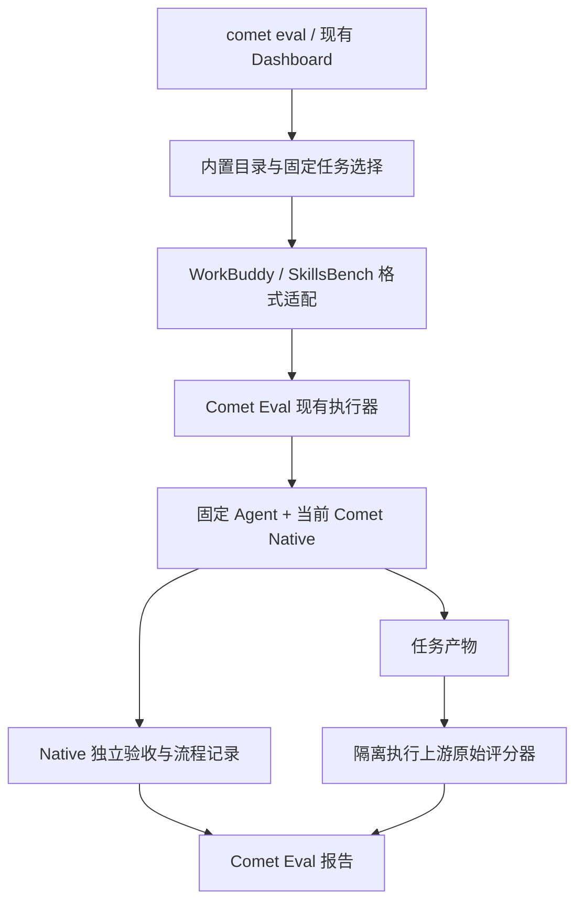

# WorkBuddy Bench、SkillsBench 接入 Comet Eval 调查

调查日期：2026-11-02。方案按后续对话收敛：仅评测 Native，优先复用 Comet Eval 执行器，首期不建设两套上游执行器桥接。未运行任何模型、容器或 Oracle Eval。

## 上游结论

两套基准登记为内置数据源，按需下载固定版本；优先由现有 Comet Eval 执行器运行 Native，分别适配上游任务格式、环境和原始评分。Harbor/BenchFlow 的事实调查保留作实现参考：只有某项必要能力无法合理独立复用时，才评估局部依赖或执行器桥接。不能把任务简化为提示词，也不能仅凭同名 TOML 文件判定兼容。

| 项目            | 建议固定的来源                                                                                                                   | 任务与格式                                                                                                                       | 执行依赖                                                                        |
| --------------- | -------------------------------------------------------------------------------------------------------------------------------- | -------------------------------------------------------------------------------------------------------------------------------- | ------------------------------------------------------------------------------- |
| WorkBuddy Bench | `Tencent/workbuddy-bench` 框架提交 `625b2233093ae4f23e76be28c1f341d41cc70373`；数据另行固定 Hugging Face revision 与归档 SHA-256 | 四个 v1.0 子集：Code 80、Web 70、Office 50、Security 60；`dataset.toml`、`instruction.md`、`task.toml`、`environment/`、`tests/` | Python ≥ 3.12、uv、Docker；框架固定 Harbor `v0.18.0`，使用自定义环境与 verifier |
| SkillsBench     | GitHub `v1.1`，任务提交 `b63b7b2850226b6aa4fb5929a8c1ac7bc4d9a6af`                                                               | 87 个活跃任务、8 类；原生 `task.md`、`environment/`、`oracle/`、`verifier/`；另有 14 个排除任务                                  | BenchFlow `>=0.6.3,<0.7`；首次实现宜进一步固定到 `0.6.3`；可用本地 Docker       |

来源：[WorkBuddy 数据说明](https://github.com/Tencent/workbuddy-bench/blob/625b2233093ae4f23e76be28c1f341d41cc70373/datasets/README.md)、[依赖声明](https://github.com/Tencent/workbuddy-bench/blob/625b2233093ae4f23e76be28c1f341d41cc70373/pyproject.toml)、[SkillsBench v1.1 发布说明](https://github.com/benchflow-ai/skillsbench/releases/tag/v1.1)、[固定任务树](https://github.com/benchflow-ai/skillsbench/tree/b63b7b2850226b6aa4fb5929a8c1ac7bc4d9a6af/tasks)。本次通过 GitHub tree 核对 SkillsBench 固定提交中确有 87 个 `tasks/*/task.md`；WorkBuddy 数量来自官方数据说明，未下载归档重新计数。

## WorkBuddy Bench 的接入边界

### 数据包与执行环境

GitHub 仓库保存框架；四份数据归档在 [tencent/workbuddy-bench](https://huggingface.co/datasets/tencent/workbuddy-bench)。官方估计压缩体积分别约 196、22、10、479 MB。任务的 `environment/workspace.tar.gz` 应保留压缩状态，由任务 Dockerfile 在容器内展开到 `/workspace`，不能用 Comet 的通用工作目录替换整个任务环境。[数据包布局](https://github.com/Tencent/workbuddy-bench/blob/625b2233093ae4f23e76be28c1f341d41cc70373/datasets/README.md)

官方下载脚本目前读取 Hugging Face `main`，校验文件获取失败会跳过校验。因此 Comet 可复用其归档来源与布局，不能直接继承这个可变、尽力校验的下载行为。建议登记固定 revision 和预期摘要；缺少摘要或内容不匹配时报告不可用，禁止继续执行。[下载脚本](https://github.com/Tencent/workbuddy-bench/blob/625b2233093ae4f23e76be28c1f341d41cc70373/scripts/dataset/fetch-dataset.sh)

执行链为模型、harness、数据集、job 配置合并，生成 resolved manifest 和 Harbor runtime config，再调用 Harbor。任务镜像与 Agent CLI 分离，CLI 通过只读镜像挂载。扩展点是 Harbor `BaseInstalledAgent` 子类，其职责包括 `install()`、`run()` 和运行后的轨迹、token 提取。Comet 应复用任务环境、原始评分和固定 Agent 平台，在 Agent 执行层增加 Native，而不是把 Comet Runtime 当作独立推理 Agent。[配置](https://github.com/Tencent/workbuddy-bench/blob/625b2233093ae4f23e76be28c1f341d41cc70373/configs/README.md)、[harness 扩展](https://github.com/Tencent/workbuddy-bench/blob/625b2233093ae4f23e76be28c1f341d41cc70373/configs/harnesses/HARNESS_AUTHORING.md)

### 评分不能统一改写为 pytest 是否通过

| 子集     | 上游评分实现                                               | 接入要求                                                       |
| -------- | ---------------------------------------------------------- | -------------------------------------------------------------- |
| Code     | 任务 `tests/verifier.toml` 指向 pytest 或原生脚本          | 原样调用并保留分数、测试结果                                   |
| Web      | 数据集专用 verifier，组合规则、LLM、VLM、Agent judge       | 保留 judge 配置、证据和罚分逻辑；不能缺少 judge 时仍称完整评测 |
| Office   | 规则检查，必要时合并 LLM judge                             | 保留任务自己的合并规则与权重                                   |
| Security | 任务自身的 `scoring.py` 或 `test_outputs.py` 写数值 reward | 保留各任务的原生评分；环境能力需逐任务核对                     |

`CompositeVerifier` 通过 `dataset.toml` 和数据集本地插件装配评分；`reward.json` 是数值结果，`score.json` 保留丰富诊断。不要只复制 `tests/` 就丢掉数据集级插件。[评分接口](https://github.com/Tencent/workbuddy-bench/blob/625b2233093ae4f23e76be28c1f341d41cc70373/configs/README.md#scoring-compositeverifier)

官方论文说明各子集使用不同评分工具，分数不能直接跨子集比较；官网当前展示又存在 Avg 列。接入报告应默认分别报告 Code、Web、Office、Security，并显式记录聚合口径，避免创造一个无明确意义的总分。[论文摘要](https://arxiv.org/abs/2607.20911)、[官网](https://workbuddybench.com/)

### 许可影响内置方式

框架使用腾讯自定义许可，包含欧盟地域限制，并要求再分发时保留许可、归属和修改说明；第三方组件继续适用原许可。Hugging Face 数据卡也标记为 `other / tencent`。因此不能把它标为 Apache-2.0，也不宜直接把完整框架和数据包混入 Comet npm 发行包。建议内置来源、版本、许可说明和适配器，数据由用户按需取得；发布前仍须核对任务归档内部的第三方许可与地域适用条件。这是依据现有文本提出的分发设计，不代表已经完成全部任务资产的许可审查。[框架许可](https://github.com/Tencent/workbuddy-bench/blob/625b2233093ae4f23e76be28c1f341d41cc70373/LICENSE)、[数据卡](https://huggingface.co/datasets/tencent/workbuddy-bench/blob/main/README.md)

## SkillsBench 的接入边界

### 必须区分论文旧版和当前发布版

早期论文描述 86 个任务、11 个领域；本次建议接入的 v1.1 是 87 个任务、8 类，且已经转为原生 BenchFlow `task.md`。官方 registry 给出逐任务 commit 和内容摘要，正式发布附带 task manifest。不能用旧 Harbor 布局解析器读取当前版本，也不能将 `tasks-extra/` 自动并入正式分母。[早期论文](https://arxiv.org/abs/2602.12670)、[v1.1 发布](https://github.com/benchflow-ai/skillsbench/releases/tag/v1.1)、[registry](https://github.com/benchflow-ai/skillsbench/blob/main/registry.json)

上游资料存在版本漂移：GitHub v1.1 发布和 registry 指向 `b63b7b2`、BenchFlow `>=0.6.3,<0.7`；Hugging Face 镜像卡仍写 `2773838`、`>=0.6.2,<0.7` 和不同 CLI 示例；固定版本 CONTRIBUTING 也存在“1.2”文字。应把 GitHub 发布清单、固定提交、依赖锁共同作为来源，禁止将这些文档中的不同版本混装。[GitHub 发布](https://github.com/benchflow-ai/skillsbench/releases/tag/v1.1)、[HF 镜像声明](https://huggingface.co/datasets/benchflow/skillsbench/blob/main/README.md)、[固定 CONTRIBUTING](https://github.com/benchflow-ai/skillsbench/blob/b63b7b2850226b6aa4fb5929a8c1ac7bc4d9a6af/CONTRIBUTING.md)

### 任务、技能、答案分别处理

`task.md` 的 YAML frontmatter 定义元数据、时间和资源；正文才是给 Agent 的需求。任务技能在 `environment/skills/`，由执行器根据 `with-skill` 或 `no-skill` 注入；`oracle/solve.sh` 是参考解，`verifier/` 是结果检查，均不能作为 Agent 上下文。应保留任务原有输入输出路径，不能统一重写为 Comet 的 `/workspace`。[任务规范](https://github.com/benchflow-ai/skillsbench/blob/b63b7b2850226b6aa4fb5929a8c1ac7bc4d9a6af/CONTRIBUTING.md)

例如 `offer-letter-generator` 要求生成 `/root/offer_letter_filled.docx`，有 900 秒 Agent 与 verifier 限时；其 verifier 运行固定 pytest 工具链，并向 `/logs/verifier/reward.txt` 写入 0 或 1。这说明 Comet 应读取原生 reward 和日志，而非要求上游 verifier 输出 Comet 自有 JSON。[示例任务](https://github.com/benchflow-ai/skillsbench/blob/b63b7b2850226b6aa4fb5929a8c1ac7bc4d9a6af/tasks/offer-letter-generator/task.md)、[示例 verifier](https://github.com/benchflow-ai/skillsbench/blob/b63b7b2850226b6aa4fb5929a8c1ac7bc4d9a6af/tasks/offer-letter-generator/verifier/test.sh)

仓库与 HF 数据卡声明 Apache-2.0；正式打包仍应保留许可证、归属和任务内第三方资料说明。官网要求基准数据不进入训练语料，实验任务、参考解与 verifier 不应自动进入 Comet 的长期学习材料。[许可证](https://github.com/benchflow-ai/skillsbench/blob/b63b7b2850226b6aa4fb5929a8c1ac7bc4d9a6af/LICENSE)、[官网声明](https://www.skillsbench.ai/)

### Native 多轮桥接的源码证据与未验证项

BenchFlow `v0.6.3` 提供 `register_agent()`，可登记安装命令、启动命令、环境和技能路径；已有 Claude、Codex 的 ACP 接入。`RolloutConfig` 提供 `pre_agent_hooks`、场景、`user`、`max_user_rounds` 等能力；Session 契约有 `prompt()`、`cancel()` 和 `on_ask_user()`。这些接口支持“在任务容器安装固定 Comet，再通过固定 Agent 会话执行 Native”的设计方向。[Agent registry](https://github.com/benchflow-ai/benchflow/blob/v0.6.3/src/benchflow/agents/registry.py)、[RolloutConfig](https://github.com/benchflow-ai/benchflow/blob/v0.6.3/src/benchflow/rollout/_config.py)、[Session 契约](https://github.com/benchflow-ai/benchflow/blob/v0.6.3/src/benchflow/agents/protocol.py)

但 registry 中出现 `cli`、`session-factory` 字段，并不证明默认执行路径已经支持任意 CLI：此版本 `Rollout.connect()` 仍直接调用 `connect_acp()`。若未来选择 BenchFlow 执行器桥接，可优先验证受支持的 ACP Agent；自定义普通 CLI 入口仍属待验证项。当前首期方案复用 Comet 执行器，不以 ACP 桥接为前置条件。[实际连接路径](https://github.com/benchflow-ai/benchflow/blob/v0.6.3/src/benchflow/rollout/__init__.py)、[默认执行适配](https://github.com/benchflow-ai/benchflow/blob/v0.6.3/src/benchflow/rollout_planes.py)

ACP 工具权限的默认自动批准不等于 Native 对需求、方案、候选的业务批准。应由显式标注的评测用户控制器读取当前 Native 状态和请求，在有限轮次内回复；不能让被测 Agent 自己批准，也不能读取隐藏 verifier 结果来提示修复。BenchFlow 的用户循环和会话接口只是可复用机制，真实 Native 的候选绑定、独立 Verify、停止与恢复仍需专项验证。[会话批准处理](https://github.com/benchflow-ai/benchflow/blob/v0.6.3/src/benchflow/rollout/__init__.py)、[用户循环](https://github.com/benchflow-ai/benchflow/blob/v0.6.3/src/benchflow/rollout/_user_loop.py)

## 当前 Comet 的接入位置与缺口

以下记录实施前的基线调查；后续实现与验证记录见文末。

本节依据本机 `052` 分支 `07bd301bb4c4bf65a21b2b47727c577816b7b970` 静态核对；`package.json` 为 `0.5.2`。开始调查时工作区干净，website 子模块为 `f462c55f12b2da17a78279304463219d87a8309f`。没有沿用历史版本记忆作为当前事实。

| 位置                                                                                                                                                                                                           | 当前能力                                                                              | 接入时需要处理                                                                                                                                                                |
| -------------------------------------------------------------------------------------------------------------------------------------------------------------------------------------------------------------- | ------------------------------------------------------------------------------------- | ----------------------------------------------------------------------------------------------------------------------------------------------------------------------------- |
| [CLI 定义](../../app/cli/index.ts)、[Eval 命令](../../app/commands/eval.ts)                                                                                                                                    | Skill、manifest、SDK application 目标；task/profile/collect；local/langsmith/langfuse | 没有外部 dataset 选择与固定版本解析，也没有公开 count/treatment 选项；suite 保持报告去向语义                                                                                  |
| [任务模型](../../eval/scaffold/python/tasks.py)、[manifest 任务](../../eval/scaffold/python/manifest_tasks.py)                                                                                                 | instruction.md + Comet task.toml + environment/validation；inline/source 任务         | 上游同名 task.toml 不等于同一 schema；SkillsBench task.md 另有解析器。不得只拷题面或自动改写验收                                                                              |
| [验证执行](../../eval/scaffold/python/utils.py)                                                                                                                                                                | Python/JS/TS 验证脚本，passed/failed JSON                                             | 不能直接执行上游 test.sh 并理解 reward.json；需保留原 verifier 的入口、环境、退出语义和原始输出                                                                               |
| [Native treatment](../../eval/local/treatments/comet/comet_native_phase1.yaml)、[Native 适配](../../eval/scaffold/python/native_eval.py)                                                                       | COMET_NATIVE_SDK_CURRENT；CONTROL；业务与工作流检查拆分                               | 对接时必须保留 Native 实际 Runtime、独立 Verifier 和当前候选证据                                                                                                              |
| [动态目标](../../eval/local/tests/conftest.py)                                                                                                                                                                 | --skill-path / manifest 会生成 DYNAMIC_SKILL                                          | native_eval.py 根据固定 treatment 名选择 Native prompt 与硬检查；因此指向 Native Skill 目录本身不保证执行 Native 专用适配。这是静态接入缺口，未作为已复现缺陷或已修复问题报告 |
| [profile](../../eval/scaffold/python/profiles.py)、[测试上下文](../../eval/local/tests/conftest.py)                                                                                                            | 通用和 Comet profile、自动用户                                                        | comet-workflow 会附加要求调用 /comet 的 Classic 规则；外部业务题应使用中性题面、共同交互协议和单独的 Native treatment，避免向 Native 注入 Classic 规则                        |
| [应用评估](../../domains/eval/application-eval.ts)                                                                                                                                                             | 固定应用快照和生成任务复用                                                            | 当前 reusableTasks 要求 2–4 个生成记录内任务，不适合把整个外部 benchmark 直接塞入现有应用发布验收路径                                                                         |
| [运行管理](../../domains/eval/eval-run-types.ts)、[启动](../../domains/eval/eval-run-entry.ts)、[证据存储](../../domains/eval/eval-run-store.ts)、[配对比较](../../eval/scaffold/python/aligned_comparison.py) | 运行生命周期、预期样本矩阵、证据指纹、任务配对、Dashboard 观测                        | 扩展数据集来源，绑定上游版本/协议/镜像/判分器；保留数值原始成绩，不能只映射为布尔 pass                                                                                        |

[现有实验设计](./2026-10-23-comet-vs-native-agent-evaluation-plan.md) 中的配对、预算和隔离原则可以延续，但其中历史实现判断不能代替本次源码核对。

## 确定的实施方向

目标：用户从公开 `comet eval` 入口选择内置数据集，用当前候选 Comet Native 完成任务，查看原始业务成绩、Native 流程完成情况、耗时和成本。

首期只运行 Native 一个实验条件。不做 CONTROL、领域 Skills 消融或 A/B 对比，也不声称证明 Native 优于其他 Agent。默认不额外注入 benchmark 附带的领域 Skills；保留原题要求的库、工具和输入文件，不为关闭 Skills 删除必要任务依赖。若某题明确要求调用专用 Skill，则提前标注与本模式不兼容，不能暗改题意后纳入成绩。

“内置”包括发布目录、固定来源、任务选择、下载准备和报告能力。完整数据按需获取，不随每次 npm 安装捆绑。数据集、当前支持子集和本次选中任务应分别展示；尚不支持的任务必须明确标注，不能把部分接入描述成全量可运行。

首期交付 WorkBuddy Code 与 SkillsBench v1.1 中经过适配的任务。WorkBuddy Web、Office、Security 后续按环境和评分需求扩展；SkillsBench 也不能仅凭清单可解析就宣称全部 87 题兼容。

## 执行结构

优先复用当前运行管理、Agent 适配、模拟用户、容器生命周期和报告。新增数据适配层负责保留任务元数据、原始需求、环境配置、工作目录、输入输出路径、时限与评分入口；不得要求所有任务改用相同工作目录，也不得重写上游判分规则。

首个实现步骤就检查代表题的环境与评分依赖。WorkBuddy 的数据集级 CompositeVerifier 插件、SkillsBench 的 verifier 脚本可能需要各自库或依赖；“不桥接整个执行器”不等于保证零上游依赖。若局部调用无法保持原始评分语义，记录确切缺口和最低必要依赖，再决定扩展。没有确认兼容的题应留在未支持清单，而非返回伪造分数。

## 实施顺序与完成条件

| 步骤                  | 实施内容                                                                       | 完成条件                                                                                       |
| --------------------- | ------------------------------------------------------------------------------ | ---------------------------------------------------------------------------------------------- |
| 1. 确认最小兼容路径   | 各选一个代表任务，检查环境、可见输入、输出位置、评分器及其依赖；固定版本与摘要 | 明确两类任务如何经过现有执行器；明确必须补充的能力，不预设整套框架桥接                         |
| 2. 内置数据集目录     | 版本锁、许可信息、任务清单、按需获取/缓存、任务选择与静态 collect              | collect 列出实际任务和缺失资源，不调用模型或 Docker，不自动生成替代题                          |
| 3. 任务与评分适配     | 两种格式映射、原环境装配、上游原始评分、日志与产物收集                         | 固定 fixture 覆盖解析/路径/分数/失败状态；既保留数值 reward，也保留原始证据                    |
| 4. Native 完整执行    | 显式 Native 处理方式、固定当前安装、有限模拟用户回复、真实独立 Verifier        | 通过公开 Runtime 创建并推进 SDK Native Run；提示与校验不落入普通 DYNAMIC_SKILL 或 Classic 协议 |
| 5. 公开入口与报告交付 | CLI 运行、停止、失败保留与恢复；现有 Dashboard 可观察结果                      | 任务成绩和 Native 结果分开；超时、判分错误、未完成样本不消失，费用未知不记零                   |
| 6. 获准后试跑         | 先每个数据集 1 题、Native 各 1 次，再另行决定扩大样本                          | 先证明环境、真实 Agent、独立验收和评分能连通，再讨论整体成绩                                   |

步骤 1–5 先实施和做普通定向测试；真实容器/Oracle/模型 Eval 的验收证据留到用户明确授权的步骤 6，不能提前宣称通过。

CLI 具体名称在实施时按现有接口核定。需要支持的能力是：列出数据集、选择 dataset/version/task、静态预览、指定 Native 执行和重复次数。候选参数 `--dataset`、`--treatment`、`--count` 尚未实现，不能作为现有命令执行。保留 `--suite` 的报告去向语义，模型和 Agent 复用已有参数。首期复用现有 Dashboard 结果展示；若运行入口必须扩字段，则仅补必要选择与透传，不扩展为新 Dashboard 项目。

## Native 执行与评分规则

- 使用固定 Agent 平台和模型、固定当前 Comet 安装内容，真实调用 Native。为每题创建隔离工作区、会话和运行状态；不把上一题的记忆带到下一题。
- 复用现有模拟用户能力并限制为预先确定的业务事实和授权策略。明确记录其模拟身份，需求确认、验收和归档决定作为实际用户角色事件，Builder 不自批。
- Native 独立 Verifier 使用真实独立会话和当前候选证据。它可检查公开验收，但不能读取上游隐藏答案或评分器。不能通过预先构造“通过”结果代替独立验收。
- oracle、隐藏 tests/verifier 和评判凭据与 Agent 工作区隔离。任务结束后执行原始评分，隐藏评分结果不回流为当次修复提示。
- 保留原始任务要求、数据、资源和路径，记录 Native 指令、多轮控制和预算等协议调整。报告标为 Comet Native 适配评测，不称为官方榜单复现。

报告至少分开给出：

| 项目        | 内容                                                                   |
| ----------- | ---------------------------------------------------------------------- |
| 任务结果    | 原始 reward、成功条件、逐题结果、分子与分母、数据集/子集范围           |
| Native 结果 | Skill 调用、SDK Run 归属、候选绑定、独立验收、批准顺序和终态           |
| 执行代价    | 总耗时、token、成本、模拟用户/子 Agent/Verifier 开销，外部评分费用另列 |
| 失败原因    | 环境或适配错误、模型任务失败、Native 流程失败、超时、缺结果            |

不同评分体系不强行汇总成一个“总通过率”。任务成功但 Native 未完成、Native 完成但原始评分失败都应可见。选中任务运行后失败要保留在本次计划中；发现不兼容时说明原因和范围变化，不自动换一道题。

## 模块范围与测试

| 范围                     | 职责                                                 |
| ------------------------ | ---------------------------------------------------- |
| `domains/eval/`          | 目录、版本、任务选择、运行计划与证据身份、结果归一化 |
| `app/`                   | 公开选择/预览/启动入口，复用领域逻辑                 |
| `eval/scaffold/`         | 任务环境装配、原始评分调用、Native 执行适配          |
| `platform/`              | 按需复用或补充下载、缓存和受控进程能力               |
| 现有 Eval/Dashboard 报告 | 读取同一运行与成绩契约，保留原始日志和诊断           |

不修改 Native/Classic 状态机以迁就 benchmark，不扩大 Creator 应用验收的固定任务规模，不新增项目级快照预算。新增源码入口和依赖按仓库架构规则登记。website 和无关工作区文件保持原状。

先运行覆盖当前差异的最小测试：数据集解析和版本锁、下载摘要与缓存路径、CLI collect、原始分数解析、缺结果/超时、Native 处理方式、停止/恢复与证据绑定。使用 fixture 和 mock 子进程验证普通逻辑，不默认运行全量测试；涉及发布资产和构建时补对应 build/打包验证。产品交付时按 master/tag 基线决定版本与英文 Changelog，不提前为本计划升级版本。

## 试跑计划与授权边界

首个候选试跑范围：WorkBuddy Code 1 题、SkillsBench 1 题，仅 Native，各 1 次，共 2 次任务运行。题目 ID、固定 Agent/模型、预算、时限、模拟用户和独立验收的调用范围，在任务适配后形成明确运行清单。

连通后可建议 WorkBuddy Code 6 题 + SkillsBench 6 题，仅 Native 各 1 次，共 12 次任务运行；这是后续建议，不是自动续跑或已有授权。正式规模和重复次数依据目标、试跑成本与失败情况另定。

目前“准备开始”对应方案收敛与开工准备，未指定 Eval 的场景、题目和轮次，不作为启动授权。可以继续完成实现与普通定向测试；模型、容器和 Oracle Eval 必须遵守根 AGENTS.md 的明确启动授权要求。模型选择在真实运行前确定，不阻塞数据接入实现。

## 当前交付与验证边界

### 后续确认的 Dashboard 要求

用户明确要求 Dashboard 可选择 WorkBuddy Bench 与 SkillsBench。页面加载、展开选项和切换数据集只读取随包分发的元数据；用户主动点击“下载数据集”后才联网下载，不因选择而自动下载，更不能顺带启动 Eval。界面展示未下载、下载中、已缓存、下载失败和版本不匹配状态，失败可重试，版本及摘要匹配时复用缓存。下载前展示来源、版本、体积说明和必要的许可信息。

npm 只包含目录元数据、任务格式与评分适配器及必要执行代码，不捆绑完整数据归档、展开数据或容器镜像。完整数据按需存入 Eval 缓存，保持安装包大小与数据集规模分离。

Dashboard 选择与按需下载入口现已实现，覆盖状态轮询、许可、失败重试、缓存复用和任务多选；数据集配置接入现有预览与受管运行入口。页面读取和切换选项不发起下载或 Eval。前端交互采用模拟下载响应验证，服务端使用临时项目与受控执行器测试；本轮未重复下载大型数据集，也未运行真实模型 Eval。

本轮 Dashboard 验证：73 项 TypeScript 定向测试（下载/缓存、预览、worker、HTTP 路由、历史配置及 CLI 下载入口）、9 项 Python 适配测试、4 项 Playwright 浏览器测试通过。浏览器覆盖桌面与 390px 窄屏、只选不下载、许可、失败重试、缓存复用、切换两个已缓存数据集后预览，以及原有本地目标流程。类型、lint、架构、相关格式和生成物校验通过；npm dry-run 中下载缓存文件数为 0。

完整 `pnpm build` 在重写现有 `comet-native-hook-guard.mjs` 时遭遇 Windows `UNKNOWN` 文件写入错误，该轮完整命令未通过。随后生成物校验确认资产已匹配源码，并分别完成 TypeScript 编译、Native CLI facade 和 Dashboard 构建，恢复了被 build 清理的 dist。未将分步构建记作完整命令通过。

- 已实现首期内置目录、固定版本下载、只读收集、Native 单组执行适配、候选副本原始评分与现有报告接入。操作见 [使用说明](../operations/NATIVE-BENCHMARKS-ZH.md)。
- 当前分支仍为 `052`，HEAD 为 `07bd301bb4c4bf65a21b2b47727c577816b7b970`；本轮开始时仅此研究文档未跟踪。
- 已读取当前 origin/master 的版本 0.5.3，将当前候选更新为 0.5.4，同步 package/lock/manifest、英文 Changelog 和构建产生的版本引用；website 保持原引用。未提交或推送。
- 已下载固定 SkillsBench 完整归档和 WorkBuddy Code 归档并做静态收集：分别 87 题、80 题。7 个 SkillsBench 工作目录任务和 4 个 WorkBuddy repo_understanding 任务明确标为不支持；其他题的静态可解析不等于运行兼容性已通过。
- 验证：TypeScript 定向测试 61 项、Python 定向测试 92 项通过；TypeScript 编译、完整 build、ESLint（8 个无关既有 warning，无 error）、架构、生成物、相关 Prettier、shell 语法及差异检查通过。npm pack dry-run 确认编译模块与 Python 适配文件进入发行清单；未执行安装包端到端验收。
- 未运行全量测试、容器/Oracle/真实模型 Eval 或真实平台 Hook；浏览器验证仅覆盖上述 Dashboard 交互。Native 独立 Verifier 在容器内的端到端互操作仍缺实跑证据。当前结果不构成 Native 基准成绩或官方榜单复现。
- Dashboard 已加入数据集选择与按需下载，沿用结果观测与停止能力；不支持从旧 JSON 任务计划自动重试失败样本，需通过新建评估或数据集命令显式创建新 Run。
